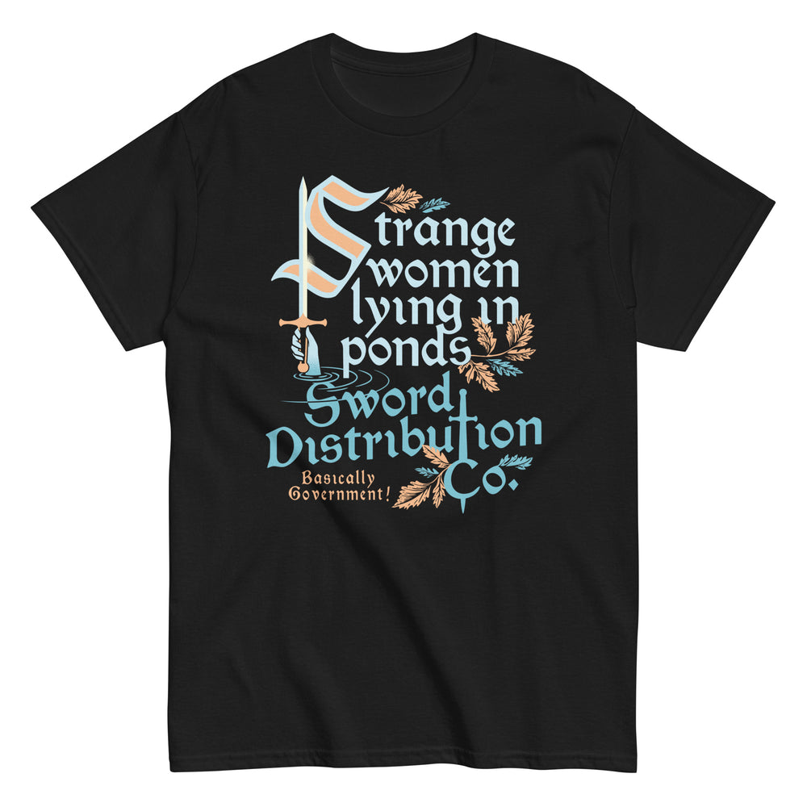

# DLS-SNORG-007 — Strange Women Lying In Ponds Sword Distribution Co Men's Classic Tee

Status: collected front-design reference; back placement unverified. No recipe classification.

- Product: https://www.snorgtees.com/products/strange-women-lying-in-ponds-sword-distribution-co-mens-classic-tee
- Seller: SnorgTees; individual designer unknown.
- Collection: https://www.snorgtees.com/collections/best-sellers
- Observed: 2026-10-20, collection default order, position 6, first displayed page. Product feed agrees with displayed order.
- Commercial signal: seller-designated bestseller collection membership, not audited sales or a sales rank.
- Source image: https://cdn.shopify.com/s/files/1/0584/1810/2404/files/unisex-classic-tee-black-front-687164d1852ad.jpg?v=1752261855
- Retained rendition: seller CDN rendition at width 1000, unaltered.
- SHA-256: `647c67543a675ec26ae99041e0546a4c6620c2a1d4b46234f3f384d7795fe9f5`
- Eligibility: adult physical tee; complete predefined design; no identified licensed character or celebrity dependency. Front graphic directly inspected. Gallery metadata lists front renditions; no back image or explicit blank-back assurance was established. Do not claim verified front-only merchandise.
- Garment: seller-listed classic crewneck, solid colors cotton; heathers contain polyester, unspecified percentage. Fabric weight and actual worn print dimensions unknown. Image is a mockup, not a physical measurement.
- Deduplication: new source record; no within-batch artwork duplication identified; global deduplication pending.

## Visual observation

Pale blue medieval-style lettering stacks irregularly on black. An oversized peach-and-blue initial integrates an upright sword; a hand and water rings connect lettering to illustration. Peach botanical sprigs fill asymmetric gaps and balance a long descending text block. Tall center-front print, with substantial empty fabric at the sides. Small peach footer adds a competing reading. Film quotation context is a subject-affinity confound; generic Arthurian imagery is not treated as a licensed-character exclusion.

## Scope

Record visual relationships only. Apparent proportions are qualitative mockup estimates. No audience-demographic inference, sales-causality claim, or copying permission follows from collection membership.
