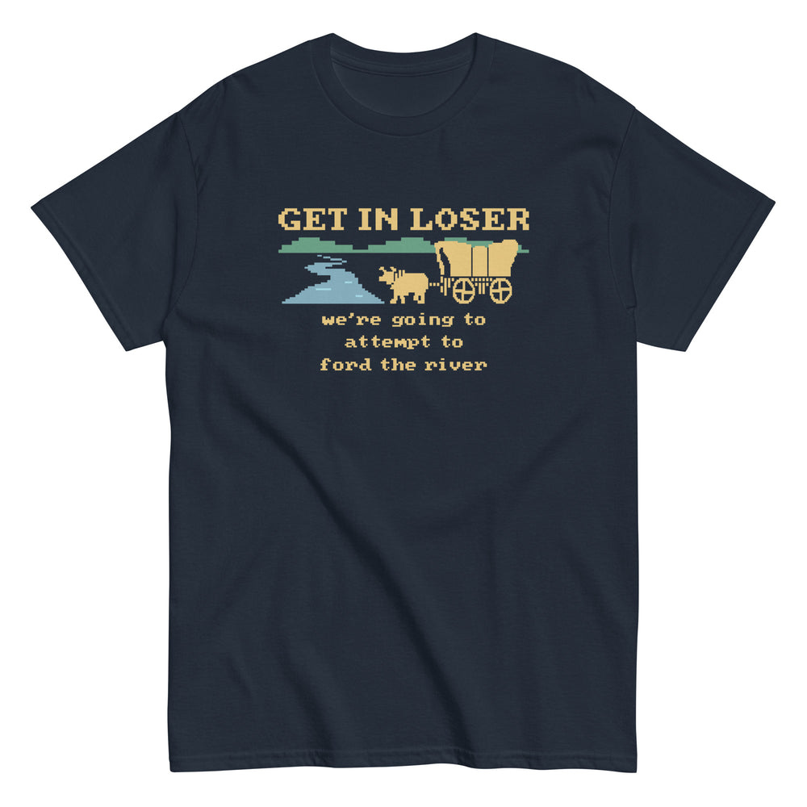

# DLS-SNORG-008 — Get In Loser We're Going To Attempt To Ford The River Men's Classic Tee

Status: collected front-design reference; back placement unverified. No recipe classification.

- Product: https://www.snorgtees.com/products/get-in-loser-were-going-to-attempt-to-ford-the-river-mens-classic-tee
- Seller: SnorgTees; individual designer unknown.
- Route: https://www.snorgtees.com/collections/best-sellers — default order, observed 2026-10-20, first displayed page, position 7; product feed agrees with displayed order.
- Commercial signal: seller-designated bestseller membership, not audited sales or sales rank.
- Source image: https://cdn.shopify.com/s/files/1/0584/1810/2404/files/mens-classic-tee-navy-front-6601e18f46a5d.jpg?v=1711399323
- Retained image SHA-256: `f6428fe97194a27bc587c40f872d5390a35b49e918edc0db040e02c0c1c91863`. Unaltered seller CDN rendition at width 1000.
- Eligibility: adult physical tee, complete predefined design, no identified licensed character or celebrity dependency. Generic animals, mythological figures and generic game motifs are not automatically excluded. Contextual references remain a potential appeal confound.
- Placement: front graphic visually inspected; no back assurance established. Gallery metadata front image names do not certify blank backs. Only the front composition is studied; production suitability remains unverified.
- Garment: seller-listed classic crewneck, cotton for solids; heathers contain polyester, ratio unspecified. Weight and actual print dimensions unknown. Apparent proportions are qualitative mockup estimates.
- Deduplication: new record, no duplicate artwork identified within collected Snorg sample; cross-source reconciliation pending.

## Visual observation

Yellow pixel capitals sit above a side-view wagon and river scene in yellow, pale blue and green. Three smaller pixel-text lines align beneath. Medium-width compact front block on navy; the shirt becomes the scene background. Deliberately coarse pixel edges unify image and type. Retro game recognition contributes to appeal; no identifiable licensed character depicted.

## Limits

No recipe grouping, audience-demographic inference, sales-causality claim or copying permission. Clothing photographs/mockups support observation, not measured production specifications.
