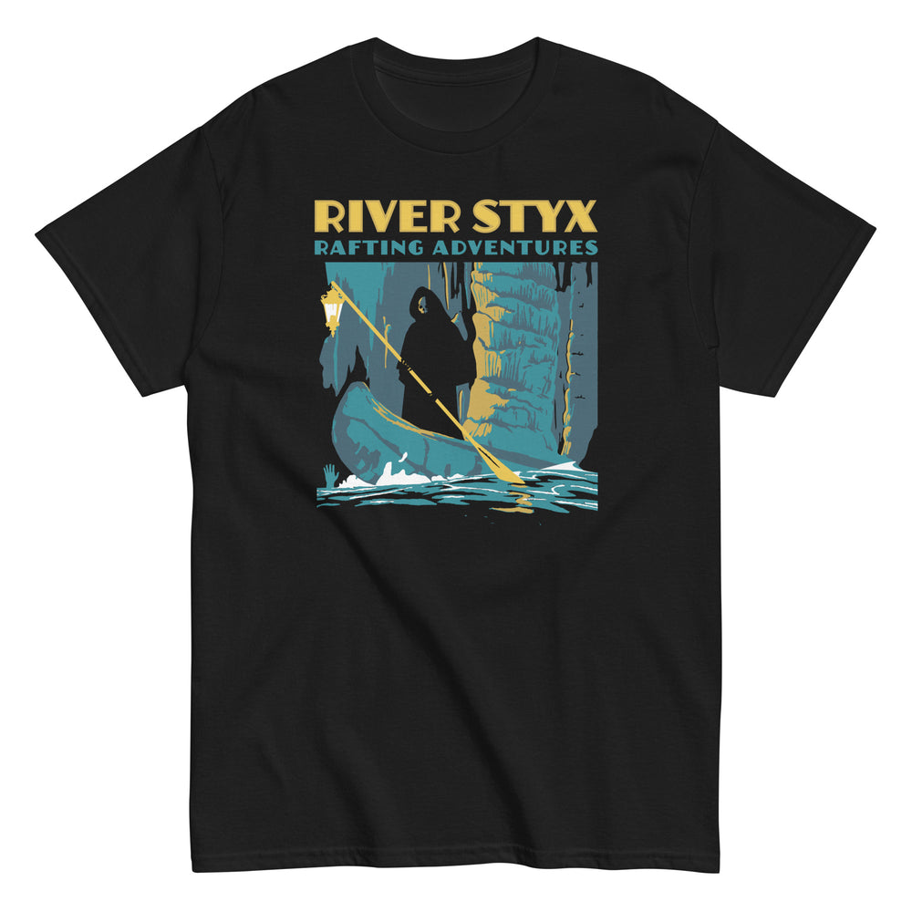

# DLS-SNORG-009 — River Styx Rafting Adventures Men's Classic Tee

Status: collected front-design reference; back placement unverified. No recipe classification.

- Product: https://www.snorgtees.com/products/river-styx-rafting-adventures-mens-classic-tee
- Seller: SnorgTees; individual designer unknown.
- Route: https://www.snorgtees.com/collections/best-sellers — default order, observed 2026-10-20, first displayed page, position 9; product feed agrees with displayed order.
- Commercial signal: seller-designated bestseller membership, not audited sales or sales rank.
- Source image: https://cdn.shopify.com/s/files/1/0584/1810/2404/files/mens-classic-tee-black-front-6532e7b76c4d7.jpg?v=1697834945
- Retained image SHA-256: `e6f674f9d8430f4c8713befbcb50472bf83377a24ccfcd6ef102272ca12219e1`. Unaltered seller CDN rendition at width 1000.
- Eligibility: adult physical tee, complete predefined design, no identified licensed character or celebrity dependency. Generic animals, mythological figures and generic game motifs are not automatically excluded. Contextual references remain a potential appeal confound.
- Placement: front graphic visually inspected; no back assurance established. Gallery metadata front image names do not certify blank backs. Only the front composition is studied; production suitability remains unverified.
- Garment: seller-listed classic crewneck, cotton for solids; heathers contain polyester, ratio unspecified. Weight and actual print dimensions unknown. Apparent proportions are qualitative mockup estimates.
- Deduplication: new record, no duplicate artwork identified within collected Snorg sample; cross-source reconciliation pending.

## Visual observation

Yellow outlined block title and teal uppercase subline cap a tall teal-gray-yellow cave illustration on black. A hooded ferryman and diagonal paddle anchor the action; black fabric supplies figure and cave shadows. White water breaks the rectangular lower edge. Large center-front travel-adventure treatment; image dominates over short title, with strong light/dark segmentation.

## Limits

No recipe grouping, audience-demographic inference, sales-causality claim or copying permission. Clothing photographs/mockups support observation, not measured production specifications.
