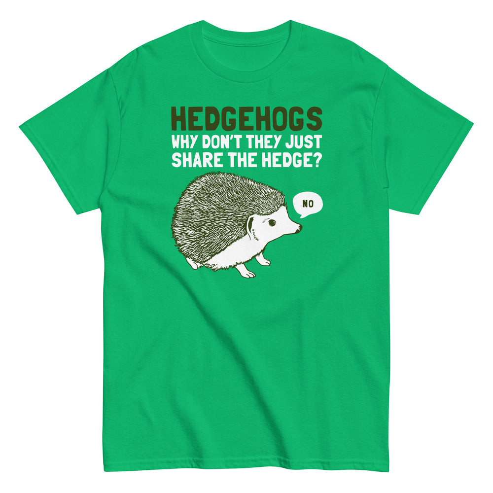

# DLS-SNORG-011 — Hedgehogs Can't Share Men's Classic Tee

Status: collected front-design reference; back placement unverified. No recipe classification.

- Product: https://www.snorgtees.com/products/hedgehogs-cant-share-mens-classic-tee
- Seller: SnorgTees; individual designer unknown.
- Route: https://www.snorgtees.com/collections/best-sellers — default order, observed 2026-10-20, first displayed page, position 11; product feed agrees with displayed order.
- Commercial signal: seller-designated bestseller membership, not audited sales or sales rank.
- Source image: https://cdn.shopify.com/s/files/1/0584/1810/2404/files/mens-classic-tee-irish-green-front-64f4d05f1e228.jpg?v=1693765736
- Retained image SHA-256: `845c9de6ba413f1a97d5e7f54d2552a852e38f37ae4028add3dfc3b55418226d`. Unaltered seller CDN rendition at width 1000.
- Eligibility: adult physical tee, complete predefined design, no identified licensed character or celebrity dependency. Generic animals, mythological figures and generic game motifs are not automatically excluded. Contextual references remain a potential appeal confound.
- Placement: front graphic visually inspected; no back assurance established. Gallery metadata front image names do not certify blank backs. Only the front composition is studied; production suitability remains unverified.
- Garment: seller-listed classic crewneck, cotton for solids; heathers contain polyester, ratio unspecified. Weight and actual print dimensions unknown. Apparent proportions are qualitative mockup estimates.
- Deduplication: new record, no duplicate artwork identified within collected Snorg sample; cross-source reconciliation pending.

## Visual observation

Dark olive condensed animal-name headline caps two smaller bold white lines. A large white/olive crosshatched hedgehog fills the lower half with a small white speech bubble beside its head. Broad center-front block on saturated green. Naturalistic fur detail contrasts with simple bold type and conversational bubble; small spikes and the final bubble need distance-readability checking.

## Limits

No recipe grouping, audience-demographic inference, sales-causality claim or copying permission. Clothing photographs/mockups support observation, not measured production specifications.
