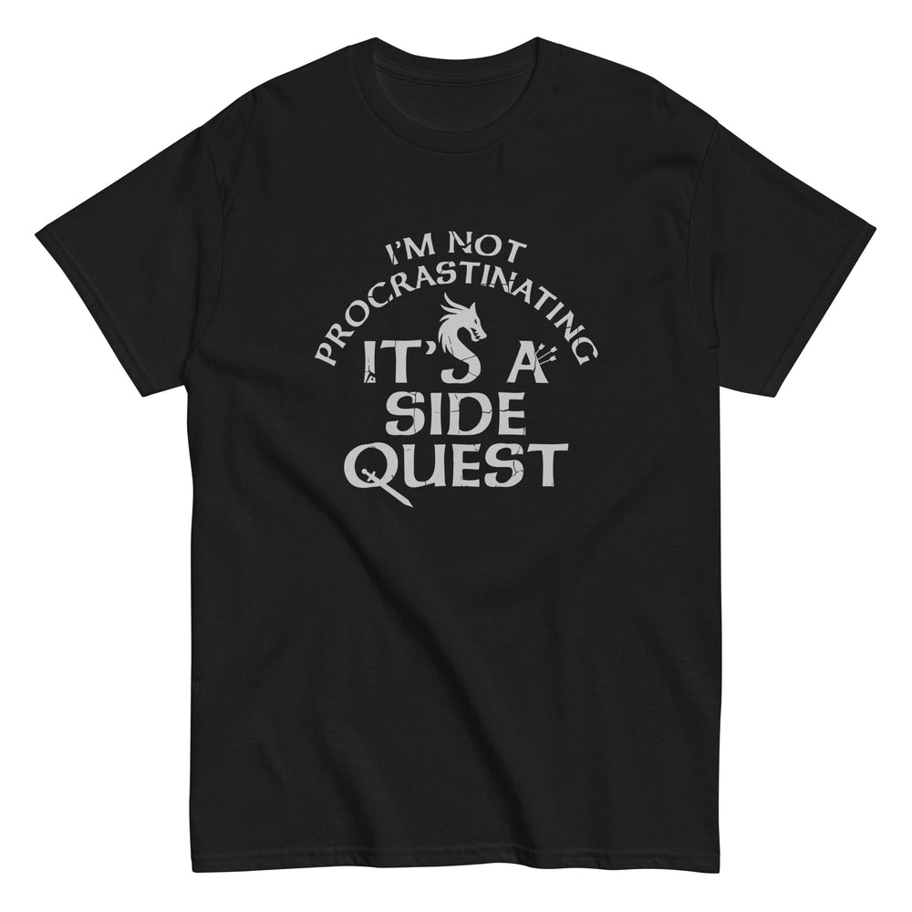

# DLS-SNORG-012 — I'm Not Procrastinating, It's A Side Quest Men's Classic Tee

Status: collected front-design reference; back placement unverified. No recipe classification.

- Product: https://www.snorgtees.com/products/im-not-procrastinating-its-a-side-quest-mens-classic-tee
- Seller: SnorgTees; individual designer unknown.
- Route: https://www.snorgtees.com/collections/best-sellers — default order, observed 2026-10-20, first displayed page, position 12; product feed agrees with displayed order.
- Commercial signal: seller-designated bestseller membership, not audited sales or sales rank.
- Source image: https://cdn.shopify.com/s/files/1/0584/1810/2404/files/mens-classic-tee-black-front-64bee675e3df6.jpg?v=1690232489
- Retained image SHA-256: `389de04ab48f42947217967cee30331bedd89803b52833dbd753fcb569b4dd53`. Unaltered seller CDN rendition at width 1000.
- Eligibility: adult physical tee, complete predefined design, no identified licensed character or celebrity dependency. Generic animals, mythological figures and generic game motifs are not automatically excluded. Contextual references remain a potential appeal confound.
- Placement: front graphic visually inspected; no back assurance established. Gallery metadata front image names do not certify blank backs. Only the front composition is studied; production suitability remains unverified.
- Garment: seller-listed classic crewneck, cotton for solids; heathers contain polyester, ratio unspecified. Weight and actual print dimensions unknown. Apparent proportions are qualitative mockup estimates.
- Deduplication: new record, no duplicate artwork identified within collected Snorg sample; cross-source reconciliation pending.

## Visual observation

Two curved gray-white serif lines form a cap over a larger stacked fantasy-serif declaration on black. A dragon head grows from a letter; tiny weapon-like details modify strokes. Compact center-front, single light ink appearance, open silhouette without a border. Type is the image, with decorative motifs subordinate to the reading; fine modifications could vanish in small printing.

## Limits

No recipe grouping, audience-demographic inference, sales-causality claim or copying permission. Clothing photographs/mockups support observation, not measured production specifications.
