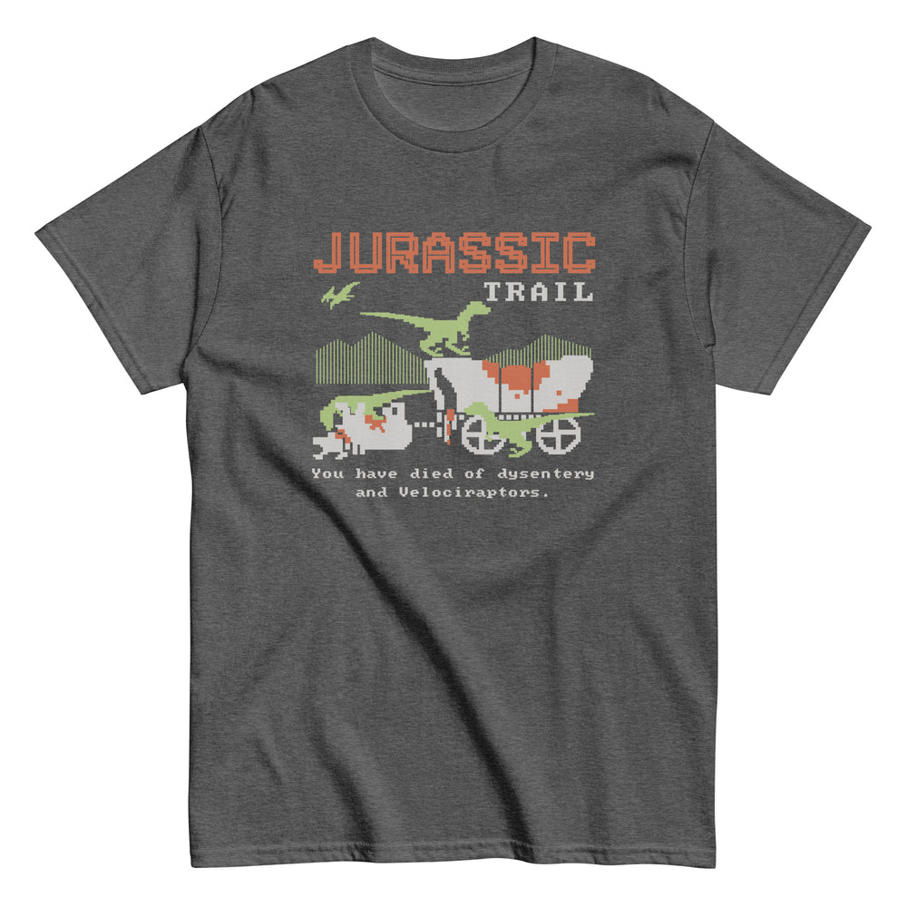

# DLS-SNORG-013 — Jurassic Trail Men's Classic Tee

Status: collected front-design reference; back placement unverified. No recipe classification.

- Product: https://www.snorgtees.com/products/jurassic-trail-mens-classic-tee
- Seller: SnorgTees; individual designer unknown.
- Route: https://www.snorgtees.com/collections/best-sellers — default order, observed 2026-10-20, first displayed page, position 14; product feed agrees with displayed order.
- Commercial signal: seller-designated bestseller membership, not audited sales or sales rank.
- Source image: https://cdn.shopify.com/s/files/1/0584/1810/2404/files/unisex-classic-tee-dark-heather-front-68518a549db63.jpg?v=1750278517
- Retained image SHA-256: `a4a100ded84bc7409a392f1cd59ec2dfd67f04f194b0786ed3c4c6c671bf2fa3`. Unaltered seller CDN rendition at width 1000.
- Eligibility: adult physical tee, complete predefined design, no identified licensed character or celebrity dependency. Generic animals, mythological figures and generic game motifs are not automatically excluded. Contextual references remain a potential appeal confound.
- Placement: front graphic visually inspected; no back assurance established. Gallery metadata front image names do not certify blank backs. Only the front composition is studied; production suitability remains unverified.
- Garment: seller-listed classic crewneck, cotton for solids; heathers contain polyester, ratio unspecified. Weight and actual print dimensions unknown. Apparent proportions are qualitative mockup estimates.
- Deduplication: new record, no duplicate artwork identified within collected Snorg sample; cross-source reconciliation pending.

## Visual observation

Orange outlined pixel headline, small white pixel subhead and a green/white/orange wagon-and-dinosaur scene form a medium central chest block on dark heather. Two tiny white pixel lines sit below. The coarse raster aesthetic unifies type and scene; thin green vertical strokes suggest scenery. Game/film mashup context may drive appeal, but the shown dinosaur is generic rather than an identifiable licensed character. Do not copy franchise styling into new work.

## Limits

No recipe grouping, audience-demographic inference, sales-causality claim or copying permission. Clothing photographs/mockups support observation, not measured production specifications.
