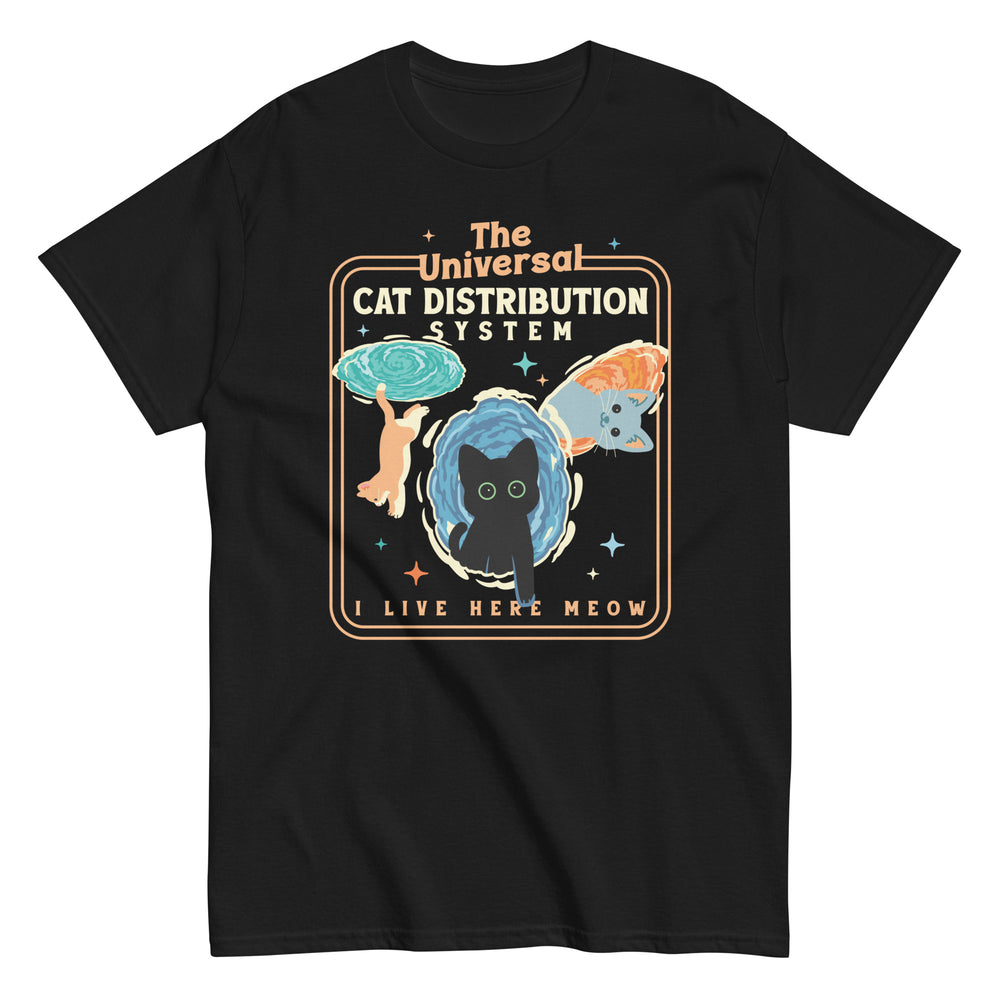

# DLS-SNORG-014 — The Universal Cat Distribution System Men's Classic Tee

Status: collected front-design reference; back placement unverified. No recipe classification.

- Product: https://www.snorgtees.com/products/the-universal-cat-distribution-system-mens-classic-tee
- Seller: SnorgTees; individual designer unknown.
- Route: https://www.snorgtees.com/collections/best-sellers — default order, observed 2026-10-20, first displayed page, position 15; product feed agrees with displayed order.
- Commercial signal: seller-designated bestseller membership, not audited sales or sales rank.
- Source image: https://cdn.shopify.com/s/files/1/0584/1810/2404/files/unisex-classic-tee-black-front-673d1461dd2f1.jpg?v=1732056172
- Retained image SHA-256: `4e35efc764c20af8c20898dcec4e0f7927deeb995387a5e68436d0f6a7ec7fcb`. Unaltered seller CDN rendition at width 1000.
- Eligibility: adult physical tee, complete predefined design, no identified licensed character or celebrity dependency. Generic animals, mythological figures and generic game motifs are not automatically excluded. Contextual references remain a potential appeal confound.
- Placement: front graphic visually inspected; no back assurance established. Gallery metadata front image names do not certify blank backs. Only the front composition is studied; production suitability remains unverified.
- Garment: seller-listed classic crewneck, cotton for solids; heathers contain polyester, ratio unspecified. Weight and actual print dimensions unknown. Apparent proportions are qualitative mockup estimates.
- Deduplication: new record, no duplicate artwork identified within collected Snorg sample; cross-source reconciliation pending.

## Visual observation

A peach double-line rounded rectangle encloses three stylized cats moving through cyan, blue and orange portals. Cream condensed capitals and tracked lettering sit above the cats; peach chunky serif words interrupt the top frame. Tiny stars and a widely tracked peach footer finish the panel. Large tall center-front on black; cat silhouette uses the shirt color. Dense framing, action and color create a contained composition, with tiny footer at risk of poor distance reading.

## Limits

No recipe grouping, audience-demographic inference, sales-causality claim or copying permission. Clothing photographs/mockups support observation, not measured production specifications.
