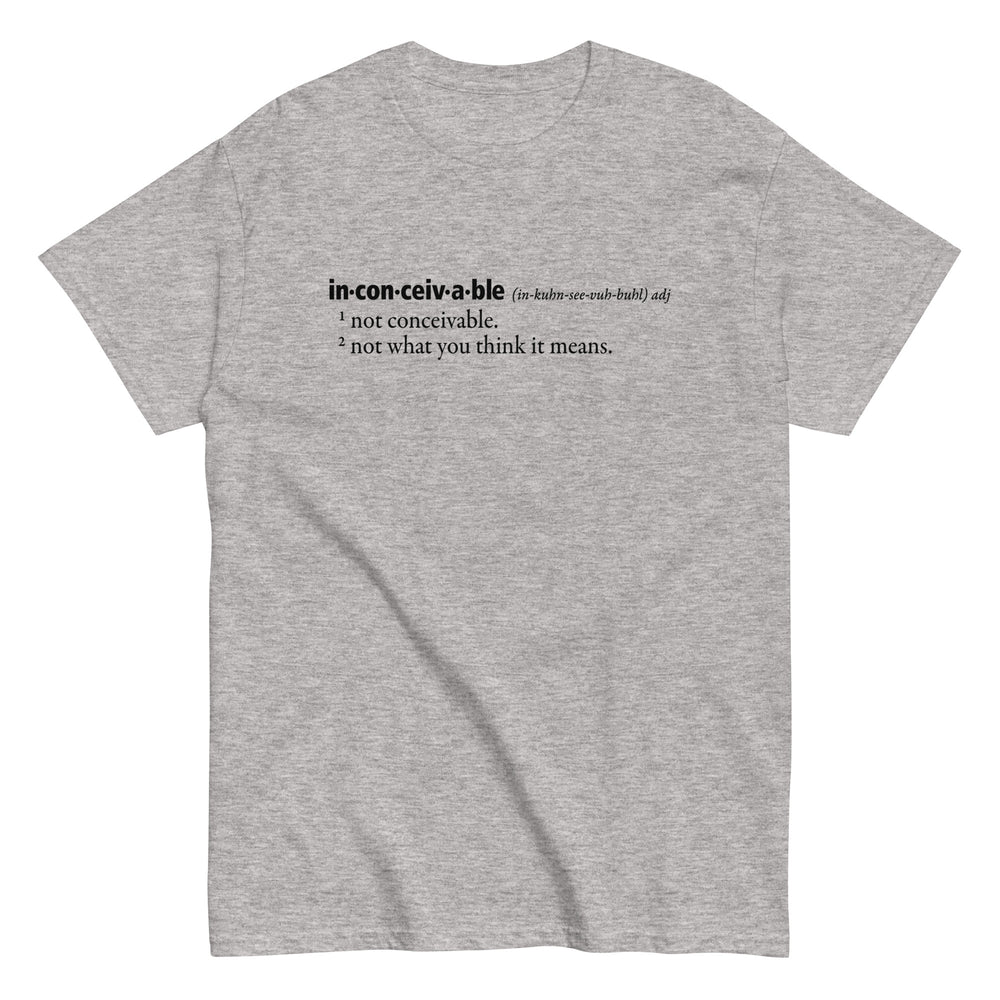

# DLS-SNORG-015 — Inconceivable Definition Men's Classic Tee

Status: collected front-design reference; back placement unverified. No recipe classification.

- Product: https://www.snorgtees.com/products/inconceivable-definition-mens-classic-tee
- Seller: SnorgTees; individual designer unknown.
- Route: https://www.snorgtees.com/collections/best-sellers — default order, observed 2026-10-20, first displayed page, position 16; product feed agrees with displayed order.
- Commercial signal: seller-designated bestseller membership, not audited sales or sales rank.
- Source image: https://cdn.shopify.com/s/files/1/0584/1810/2404/files/mens-classic-tee-sport-grey-front-6502342243d87.jpg?v=1694643248
- Retained image SHA-256: `9961daaa033ddd1243f61c0fa7e15d5066b04ec86318a24d8ddd2fd839ca24e5`. Unaltered seller CDN rendition at width 1000.
- Eligibility: adult physical tee, complete predefined design, no identified licensed character or celebrity dependency. Generic animals, mythological figures and generic game motifs are not automatically excluded. Contextual references remain a potential appeal confound.
- Placement: front graphic visually inspected; no back assurance established. Gallery metadata front image names do not certify blank backs. Only the front composition is studied; production suitability remains unverified.
- Garment: seller-listed classic crewneck, cotton for solids; heathers contain polyester, ratio unspecified. Weight and actual print dimensions unknown. Apparent proportions are qualitative mockup estimates.
- Deduplication: new record, no duplicate artwork identified within collected Snorg sample; cross-source reconciliation pending.

## Visual observation

A small horizontally oriented dictionary entry sits high on the center chest of a light gray heather tee. Bold black sans-serif headword is followed by italic pronunciation; two thinner serif definition lines align left below with superscript numbers. No illustration, frame or large headline. Large areas of bare fabric emphasize the restrained scale; small copy needs close viewing. Film-quote recognition is an appeal confound, but no named character or celebrity is shown.

## Limits

No recipe grouping, audience-demographic inference, sales-causality claim or copying permission. Clothing photographs/mockups support observation, not measured production specifications.
