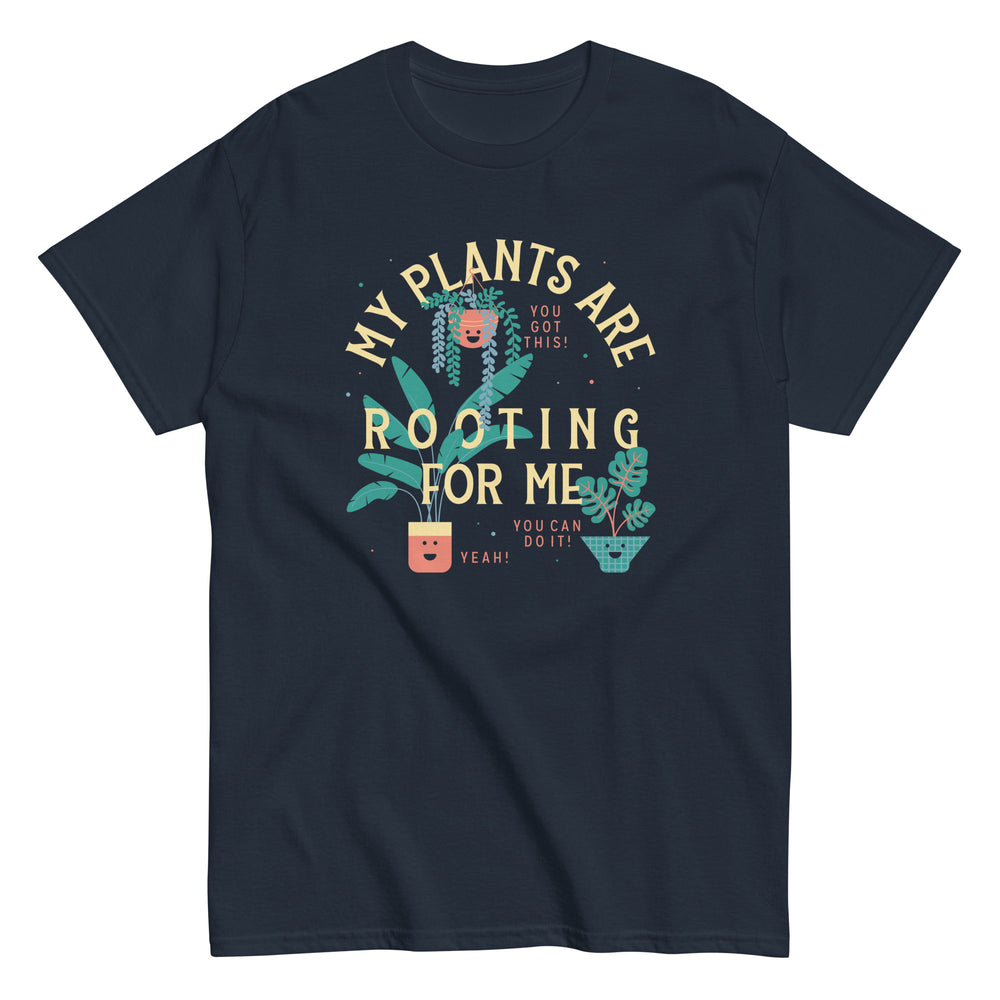

# DLS-SNORG-016 — My Plants Are Rooting For Me Men's Classic Tee

Status: collected front-design reference; back placement unverified. No recipe classification.

- Product: https://www.snorgtees.com/products/my-plants-are-rooting-for-me-mens-classic-tee
- Seller: SnorgTees; individual designer unknown.
- Route: https://www.snorgtees.com/collections/best-sellers — default order, observed 2026-10-20, first displayed page, position 17; product feed agrees with displayed order.
- Commercial signal: seller-designated bestseller membership, not audited sales or sales rank.
- Source image: https://cdn.shopify.com/s/files/1/0584/1810/2404/files/mens-classic-tee-navy-front-64c297abf0cce.jpg?v=1690474426
- Retained image SHA-256: `a306ece120bb2f8d4b2c8bfa0464700dc98959a0aea3519efbca2f4550ed7740`. Unaltered seller CDN rendition at width 1000.
- Eligibility: adult physical tee, complete predefined design, no identified licensed character or celebrity dependency. Generic animals, mythological figures and generic game motifs are not automatically excluded. Contextual references remain a potential appeal confound.
- Placement: front graphic visually inspected; no back assurance established. Gallery metadata front image names do not certify blank backs. Only the front composition is studied; production suitability remains unverified.
- Garment: seller-listed classic crewneck, cotton for solids; heathers contain polyester, ratio unspecified. Weight and actual print dimensions unknown. Apparent proportions are qualitative mockup estimates.
- Deduplication: new record, no duplicate artwork identified within collected Snorg sample; cross-source reconciliation pending.

## Visual observation

Cream serif uppercase wording arches around a hanging plant, then overlays two lower potted plants in two horizontal lines. Teal leaves and coral smiling pots separate illustrations from navy fabric. Small coral encouragement captions occupy spaces between plants. Medium-tall centered composition; illustrations and type interlock rather than remaining separate blocks. Cheerful faces and botanical details support the plant subject, while scattered small captions may compete with main reading.

## Limits

No recipe grouping, audience-demographic inference, sales-causality claim or copying permission. Clothing photographs/mockups support observation, not measured production specifications.
