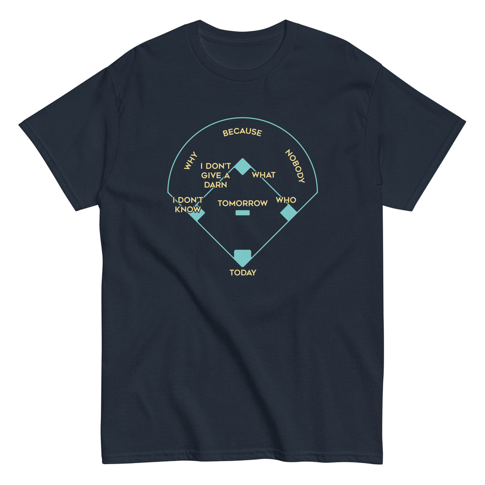

# DLS-SNORG-017 — Baseball Positions Men's Classic Tee

Status: collected front-design reference; back placement unverified. No recipe classification.

- Product: https://www.snorgtees.com/products/baseball-positions-mens-classic-tee
- Seller: SnorgTees; individual designer unknown.
- Route: https://www.snorgtees.com/collections/best-sellers — default order, observed 2026-10-20, first displayed page, position 19; product feed agrees with displayed order.
- Commercial signal: seller-designated bestseller membership, not audited sales or sales rank.
- Source image: https://cdn.shopify.com/s/files/1/0584/1810/2404/files/mens-classic-tee-navy-front-64cc190ecf207.jpg?v=1691097383
- Retained image SHA-256: `0d6a95a9612ff4ed90043cbb57c7a1bb02eb5b9298644eb0852852d7621149ce`. Unaltered seller CDN rendition at width 1000.
- Eligibility: adult physical tee, complete predefined design, no identified licensed character or celebrity dependency. Generic animals, mythological figures and generic game motifs are not automatically excluded. Contextual references remain a potential appeal confound.
- Placement: front graphic visually inspected; no back assurance established. Gallery metadata front image names do not certify blank backs. Only the front composition is studied; production suitability remains unverified.
- Garment: seller-listed classic crewneck, cotton for solids; heathers contain polyester, ratio unspecified. Weight and actual print dimensions unknown. Apparent proportions are qualitative mockup estimates.
- Deduplication: new record, no duplicate artwork identified within collected Snorg sample; cross-source reconciliation pending.

## Visual observation

A thin cyan baseball diamond and outfield arc contain small yellow sans-serif labels on navy. Filled bases and home plate provide visual anchors; no headline or enclosing rectangular ground. Airy diagram-led central print with broad fabric negative space. Labels reference a comedy routine; audience recognition is a separate factor from the diagram treatment. No celebrity likeness or name is shown. Fine lines and labels may fail at viewing distance.

## Limits

No recipe grouping, audience-demographic inference, sales-causality claim or copying permission. Clothing photographs/mockups support observation, not measured production specifications.
