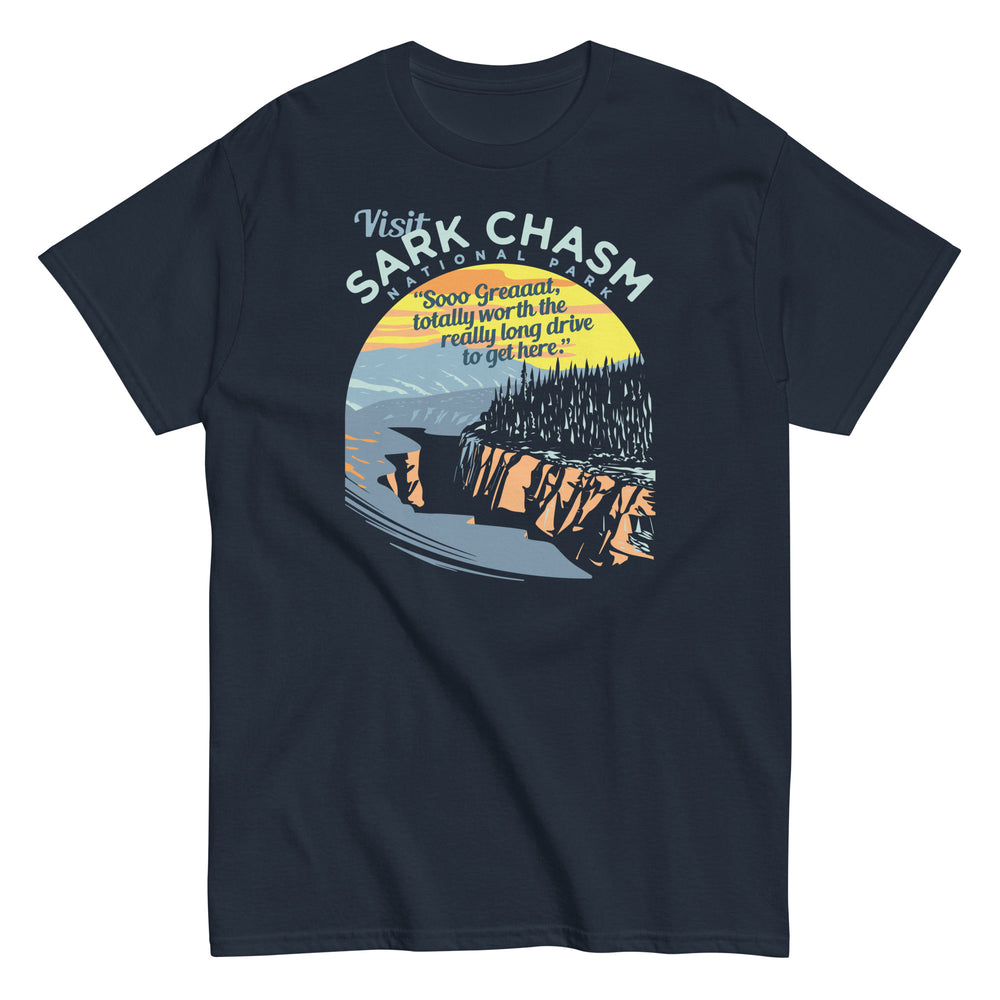

# DLS-SNORG-018 — Visit Sark Chasm Men's Classic Tee

Status: collected front-design reference; back placement unverified. No recipe classification.

- Product: https://www.snorgtees.com/products/visit-sark-chasm-mens-classic-tee
- Seller: SnorgTees; individual designer unknown.
- Route: https://www.snorgtees.com/collections/best-sellers — default order, observed 2026-10-20, first displayed page, position 20; product feed agrees with displayed order.
- Commercial signal: seller-designated bestseller membership, not audited sales or sales rank.
- Source image: https://cdn.shopify.com/s/files/1/0584/1810/2404/files/mens-classic-tee-navy-front-651d98f66b88a.jpg?v=1696438608
- Retained image SHA-256: `bcab90712bb613e3a13b7cd66e872a65f673ffbf63a076134673efd3bf7a80a7`. Unaltered seller CDN rendition at width 1000.
- Eligibility: adult physical tee, complete predefined design, no identified licensed character or celebrity dependency. Generic animals, mythological figures and generic game motifs are not automatically excluded. Contextual references remain a potential appeal confound.
- Placement: front graphic visually inspected; no back assurance established. Gallery metadata front image names do not certify blank backs. Only the front composition is studied; production suitability remains unverified.
- Garment: seller-listed classic crewneck, cotton for solids; heathers contain polyester, ratio unspecified. Weight and actual print dimensions unknown. Apparent proportions are qualitative mockup estimates.
- Deduplication: new record, no duplicate artwork identified within collected Snorg sample; cross-source reconciliation pending.

## Visual observation

Mint curved capitals and a small italic introduction sit over an arched scenic vignette. Yellow/pink sky, blue-gray mountains and orange cliffs frame a dark forest; navy garment supplies deep shadows. A dense italic quotation overlays the sky. Medium-tall center-front composition with a curved top and sloping lower edge, strongly image-led. Scenic texture and overlay text may compete; the garment remains visible around the vignette.

## Limits

No recipe grouping, audience-demographic inference, sales-causality claim or copying permission. Clothing photographs/mockups support observation, not measured production specifications.
