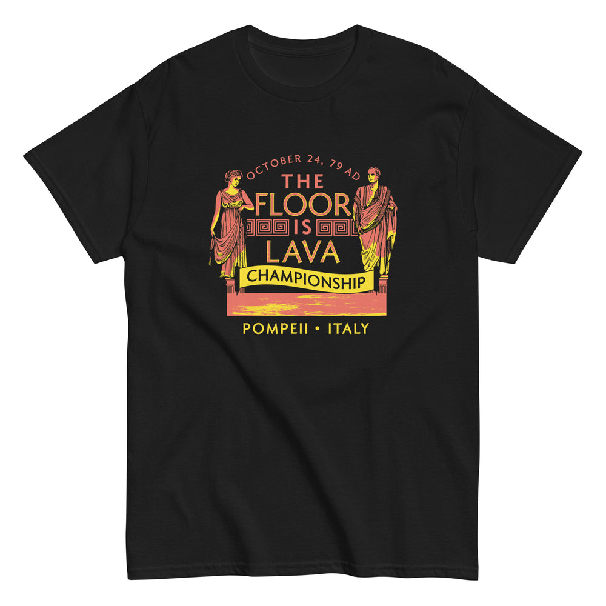

# DLS-SNORG-019 — Pompeii Floor is Lava Championship Men's Classic Tee

Status: collected front-design reference; back placement unverified. No recipe classification.

- Product: https://www.snorgtees.com/products/pompeii-floor-is-lava-championship-mens-classic-tee
- Seller: SnorgTees; individual designer unknown.
- Route: https://www.snorgtees.com/collections/best-sellers — default order, observed 2026-10-20, first displayed page, position 21; product feed agrees with displayed order.
- Commercial signal: seller-designated bestseller membership, not audited sales or sales rank.
- Source image: https://cdn.shopify.com/s/files/1/0584/1810/2404/files/mens-classic-tee-black-front-64c01d081b81f.jpg?v=1690311957
- Retained image SHA-256: `5cd64ba34afd41824a46e0b1b573a67f8ba10e82597a678268066ba6956f5190`. Unaltered seller CDN rendition at width 1000.
- Eligibility: adult physical tee, complete predefined design, no identified licensed character or celebrity dependency. Generic animals, mythological figures and generic game motifs are not automatically excluded. Contextual references remain a potential appeal confound.
- Placement: front graphic visually inspected; no back assurance established. Gallery metadata front image names do not certify blank backs. Only the front composition is studied; production suitability remains unverified.
- Garment: seller-listed classic crewneck, cotton for solids; heathers contain polyester, ratio unspecified. Weight and actual print dimensions unknown. Apparent proportions are qualitative mockup estimates.
- Deduplication: new record, no duplicate artwork identified within collected Snorg sample; cross-source reconciliation pending.

## Visual observation

Coral and yellow classical figures flank a stacked event-title block on black. A curved date caps the composition; Greek-key bands divide lines, a yellow ribbon carries a dark word, and a lava strip creates the lower base. Short location line sits beneath. Medium center-front compact near-square badge with no outer border; two warm colors and black negative space integrate figures and copy. Historical subject context must not be confused with visual-treatment appeal.

## Limits

No recipe grouping, audience-demographic inference, sales-causality claim or copying permission. Clothing photographs/mockups support observation, not measured production specifications.
