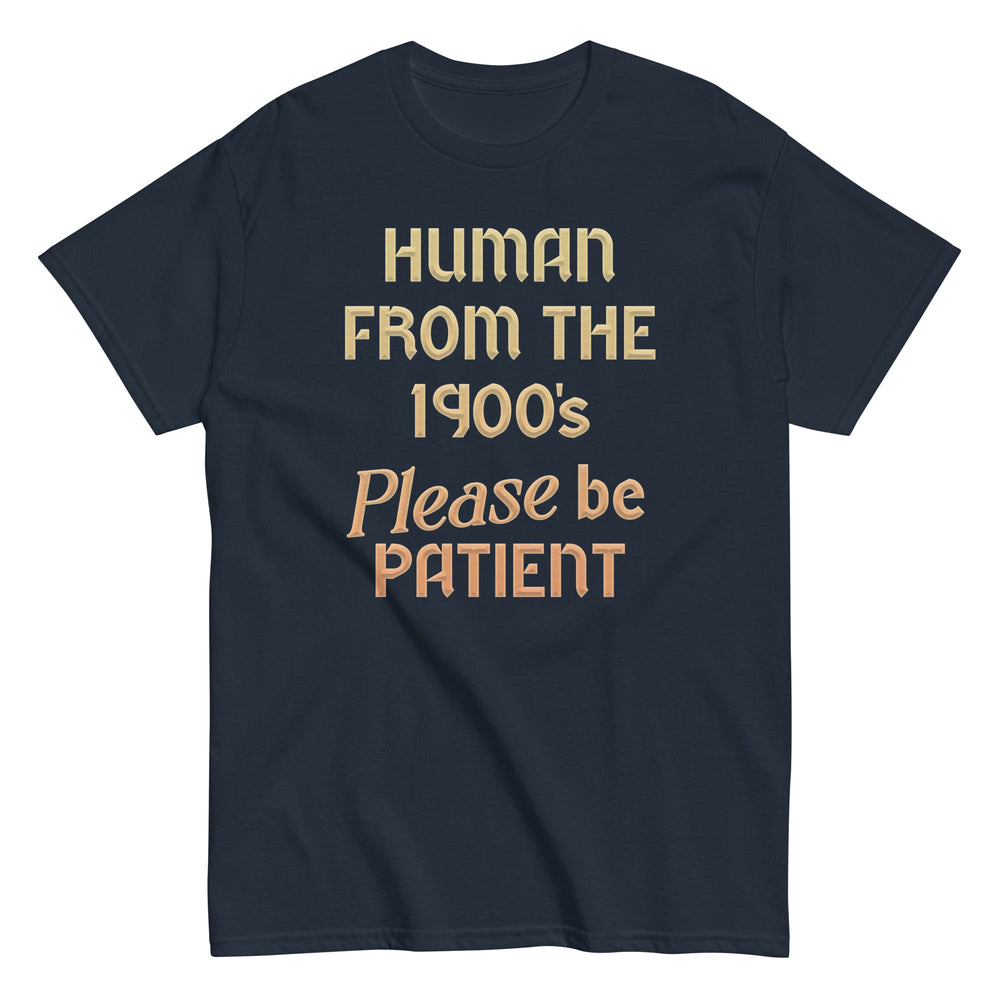

# DLS-SNORG-020 — Human From The 1900's Please Be Patient Men's Classic Tee

Status: collected front-design reference; back placement unverified. No recipe classification.

- Product: https://www.snorgtees.com/products/human-from-the-1900s-please-be-patient-mens-classic-tee
- Seller: SnorgTees; individual designer unknown.
- Route: https://www.snorgtees.com/collections/best-sellers — default order, observed 2026-10-20, first displayed page, position 22; product feed agrees with displayed order.
- Commercial signal: seller-designated bestseller membership, not audited sales or sales rank.
- Source image: https://cdn.shopify.com/s/files/1/0584/1810/2404/files/unisex-classic-tee-navy-front-6716b114b33a3.jpg?v=1729540387
- Retained image SHA-256: `b19b491742e89800325f4363088552d6989a238787f701f9d4ed14fe73ed9132`. Unaltered seller CDN rendition at width 1000.
- Eligibility: adult physical tee, complete predefined design, no identified licensed character or celebrity dependency. Generic animals, mythological figures and generic game motifs are not automatically excluded. Contextual references remain a potential appeal confound.
- Placement: front graphic visually inspected; no back assurance established. Gallery metadata front image names do not certify blank backs. Only the front composition is studied; production suitability remains unverified.
- Garment: seller-listed classic crewneck, cotton for solids; heathers contain polyester, ratio unspecified. Weight and actual print dimensions unknown. Apparent proportions are qualitative mockup estimates.
- Deduplication: new record, no duplicate artwork identified within collected Snorg sample; cross-source reconciliation pending.

## Visual observation

Five large centered lines use angular retro display letters in pale gold and peach on navy, with an italic serif word providing a change of rhythm. Slight shaded/outlined strokes add depth while the palette warms toward the bottom. Tall type-only front block, broad spacing between lines, no frame or illustration. The reader follows scale and line breaks; the final line has strong weight. Garment negative space surrounds the copy.

## Limits

No recipe grouping, audience-demographic inference, sales-causality claim or copying permission. Clothing photographs/mockups support observation, not measured production specifications.
