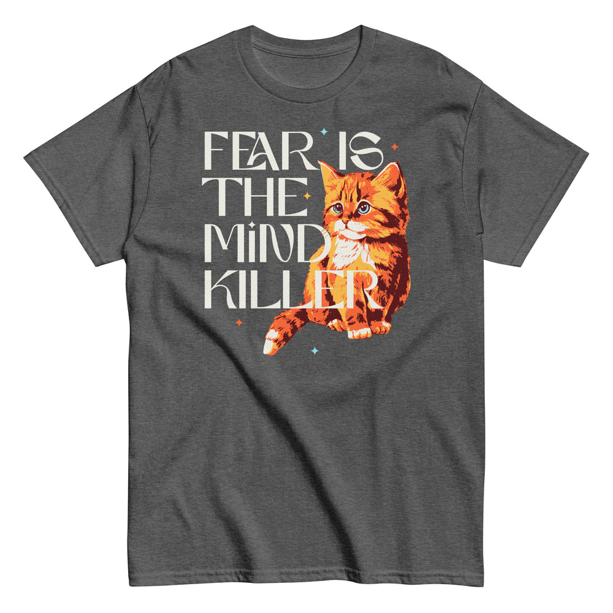

# DLS-SNORG-021 — Fear Is The Mind Killer Cat Men's Classic Tee

Status: collected front-design reference; back placement unverified. No recipe classification.

- Product: https://www.snorgtees.com/products/fear-is-the-mind-killer-cat-mens-classic-tee
- Seller: SnorgTees; individual designer unknown.
- Route: https://www.snorgtees.com/collections/best-sellers — default order, observed 2026-10-20, first displayed page, position 23; product feed agrees with displayed order.
- Commercial signal: seller-designated bestseller membership, not audited sales or sales rank.
- Source image: https://cdn.shopify.com/s/files/1/0584/1810/2404/files/unisex-classic-tee-dark-heather-front-6830c8485557d.jpg?v=1748036542
- Retained image SHA-256: `4c9a080068af07ac5690d1932ca7916cb365d8c148a2633258e26a26f0668ca5`. Unaltered seller CDN rendition at width 1000.
- Eligibility: adult physical tee, complete predefined design, no identified licensed character or celebrity dependency. Generic animals, mythological figures and generic game motifs are not automatically excluded. Contextual references remain a potential appeal confound.
- Placement: front graphic visually inspected; no back assurance established. Gallery metadata front image names do not certify blank backs. Only the front composition is studied; production suitability remains unverified.
- Garment: seller-listed classic crewneck, cotton for solids; heathers contain polyester, ratio unspecified. Weight and actual print dimensions unknown. Apparent proportions are qualitative mockup estimates.
- Deduplication: new record, no duplicate artwork identified within collected Snorg sample; cross-source reconciliation pending.

## Visual observation

Oversized thin cream display capitals form a left-aligned stack, overlapping a large orange kitten on the right. The kitten uses orange/yellow/dark maroon and white highlights; tiny colored stars punctuate the silhouette. Broad tall center-front composition on dark heather; a text stroke crosses the illustration rather than sitting in a separate panel. The contrast between solemn typography and cute naturalistic animal is visible; the literary quotation is an appeal confound, not evidence of transferable copy.

## Limits

No recipe grouping, audience-demographic inference, sales-causality claim or copying permission. Clothing photographs/mockups support observation, not measured production specifications.
