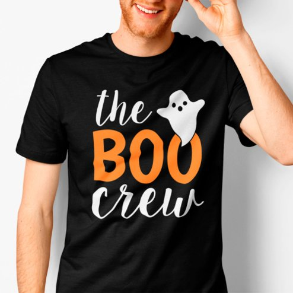

# DLS-ZZ-001 — The Boo Crew Orange Ghost Mens Halloween T-Shirt

Status: collected front-design reference; back unverified. No family synthesis.

- Product: https://www.zazzle.com/the_boo_crew_orange_ghost_mens_halloween_t_shirt-235535875928201303
- Marketplace: Zazzle. Individual creator not exposed in captured collection card; attribution unresolved.
- Discovery: https://www.zazzle.com/c/mens+tshirts; ZZ-men, page 1, product position 1; **Popular** selected, 2026-10-20. Default Safe content filter. Ads excluded from product numbering.
- Commercial signal: marketplace Popular order, not audited sales, a disclosed sales window, or proof that visual treatment caused demand.
- Source image: https://rlv.zcache.com/the_boo_crew_orange_ghost_mens_halloween_t_shirt-r_vsveiz_494.jpg
- SHA-256: `7f2ae160305f4844a300975f6df11d01091a40b31139c1c1f1d98496e89dac4b`. Retained displayed CDN image, unedited. Promotional mockup, not a physical sample.
- Eligibility: adult tee; complete predefined front design; no observed licensed character or celebrity. Back unverified. Optional editing alone is not exclusion; placeholder-dependent templates excluded.
- Garment: visible color/cut described below. Fiber, physical print dimensions and ink method unverified; estimates from mockups only.
- Deduplication: recolors of the same artwork not separately counted; global cross-source reconciliation pending.

## Visual observation

Black crew-neck with broad centered three-line chest composition. Orange heavy uppercase BOO carries the middle emphasis; white informal script above and below frames it. Small white cartoon ghost overlaps the upper-right edge of the word. Shirt black remains open between letters and ghost; print fills much of chest width.

## Limits

No exact font identification, buyer-demographic inference, family assignment or causal sales claim. Source-image resolution and model pose limit proportions. Brand, subject, gifting and promotional presentation can affect appeal independently of design language.
