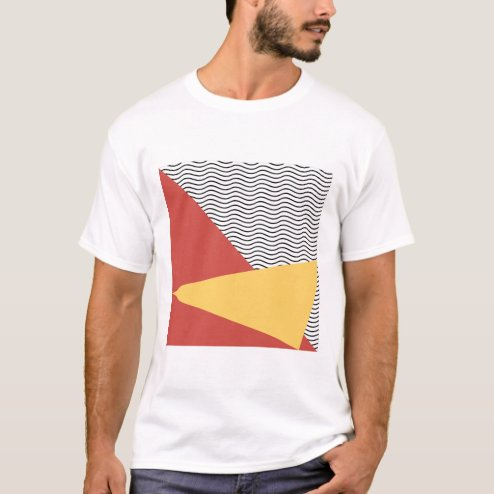

# DLS-ZZ-002 — 80s Pop art pattern men's T-Shirt

Status: collected front-design reference; back unverified. No family synthesis.

- Product: https://www.zazzle.com/80s_pop_art_pattern_mens_t_shirt-235552364705058676
- Marketplace: Zazzle. Individual creator not exposed in captured collection card; attribution unresolved.
- Discovery: https://www.zazzle.com/c/mens+tshirts; ZZ-men, page 1, product position 2; **Popular** selected, 2026-10-20. Default Safe content filter. Ads excluded from product numbering.
- Commercial signal: marketplace Popular order, not audited sales, a disclosed sales window, or proof that visual treatment caused demand.
- Source image: https://rlv.zcache.com/80s_pop_art_pattern_mens_t_shirt-re6fb83974b52485aa2c1f1605a35e3d2_k2gr0_494.jpg
- SHA-256: `d5c721781d32b1c0966310db2ad914dde0c149d9e816cfe3f36f22dba81c726c`. Retained displayed CDN image, unedited. Promotional mockup, not a physical sample.
- Eligibility: adult tee; complete predefined front design; no observed licensed character or celebrity. Back unverified. Optional editing alone is not exclusion; placeholder-dependent templates excluded.
- Garment: visible color/cut described below. Fiber, physical print dimensions and ink method unverified; estimates from mockups only.
- Deduplication: recolors of the same artwork not separately counted; global cross-source reconciliation pending.

## Visual observation

White regular crew-neck; tall centered rectangular abstract graphic, no copy. Fine black wavy lines fill the upper region; coral-red angular field and yellow wedge overlap below. Deliberately hard rectangle dominates torso. Fine linework and large flat fields create contrasting texture; retain this dense example without aesthetic screening.

## Limits

No exact font identification, buyer-demographic inference, family assignment or causal sales claim. Source-image resolution and model pose limit proportions. Brand, subject, gifting and promotional presentation can affect appeal independently of design language.
