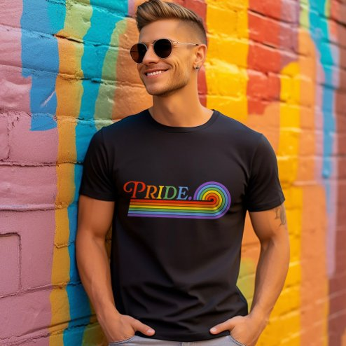

# DLS-ZZ-003 — Pride Rainbow LGBTQ Men's Basic Dark T-Shirt

Status: collected front-design reference; back unverified. No family synthesis.

- Product: https://www.zazzle.com/pride_rainbow_lgbtq_mens_basic_dark_t_shirt-235423516570874521
- Marketplace: Zazzle. Individual creator not exposed in captured collection card; attribution unresolved.
- Discovery: https://www.zazzle.com/c/mens+tshirts; ZZ-men, page 1, product position 3; **Popular** selected, 2026-10-20. Default Safe content filter. Ads excluded from product numbering.
- Commercial signal: marketplace Popular order, not audited sales, a disclosed sales window, or proof that visual treatment caused demand.
- Source image: https://rlv.zcache.com/pride_rainbow_lgbtq_mens_basic_dark_t_shirt-r_vshzu7_494.jpg
- SHA-256: `857c9f39299d6581dd8296e41cac6577bc1b92924d7e6c4364ef32ca477ce9bd`. Retained displayed CDN image, unedited. Promotional mockup, not a physical sample.
- Eligibility: adult tee; complete predefined front design; no observed licensed character or celebrity. Back unverified. Optional editing alone is not exclusion; placeholder-dependent templates excluded.
- Garment: visible color/cut described below. Fiber, physical print dimensions and ink method unverified; estimates from mockups only.
- Deduplication: recolors of the same artwork not separately counted; global cross-source reconciliation pending.

## Visual observation

Black fitted-looking crew-neck in lifestyle mockup. Small-to-medium horizontal chest word PRIDE in rainbow colors with a multistripe rainbow underline curling upward at the right. Wide surrounding black negative space; restrained print scale despite saturated multicolor treatment. Mural background is presentation, not printed artwork.

## Limits

No exact font identification, buyer-demographic inference, family assignment or causal sales claim. Source-image resolution and model pose limit proportions. Brand, subject, gifting and promotional presentation can affect appeal independently of design language.
