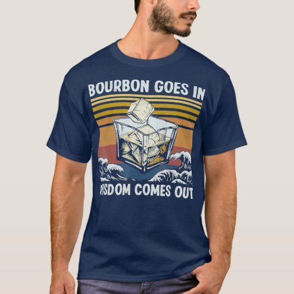

# DLS-ZZ-004 — Bourbon Goes In Wisdom Comes Out 1970s Retro T-Shirt

Status: collected front-design reference; back unverified. No family synthesis.

- Product: https://www.zazzle.com/bourbon_goes_in_wisdom_comes_out_1970s_retro_t_shirt-235392564642357621
- Marketplace: Zazzle. Individual creator not exposed in captured collection card; attribution unresolved.
- Discovery: https://www.zazzle.com/c/mens+tshirts; ZZ-men, page 1, product position 4; **Popular** selected, 2026-10-20. Default Safe content filter. Ads excluded from product numbering.
- Commercial signal: marketplace Popular order, not audited sales, a disclosed sales window, or proof that visual treatment caused demand.
- Source image: https://rlv.zcache.com/bourbon_goes_in_wisdom_comes_out_1970s_retro_t_shirt-r017b97531dc5453e8fd6f0c8e4b60f37_k2g9y_494.jpg
- SHA-256: `4d3d766652ece4df081ea8d388601b09bc3a29994d1ff37ee60fd7752e1bd478`. Retained displayed CDN image, unedited. Promotional mockup, not a physical sample.
- Eligibility: adult tee; complete predefined front design; no observed licensed character or celebrity. Back unverified. Optional editing alone is not exclusion; placeholder-dependent templates excluded.
- Garment: visible color/cut described below. Fiber, physical print dimensions and ink method unverified; estimates from mockups only.
- Deduplication: recolors of the same artwork not separately counted; global cross-source reconciliation pending.

## Visual observation

Navy regular crew-neck with broad centered print. White bold uppercase setup above, punchline below; large outlined whiskey tumbler with ice anchors the center. Yellow-orange retro horizontal stripes and sunset field sit behind the glass; worn texture softens the block. Glass overlaps stripes, linking illustration with copy rhythm.

## Limits

No exact font identification, buyer-demographic inference, family assignment or causal sales claim. Source-image resolution and model pose limit proportions. Brand, subject, gifting and promotional presentation can affect appeal independently of design language.
