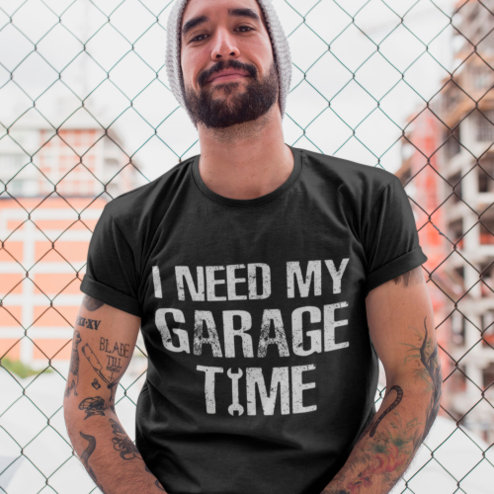

# DLS-ZZ-005 — I need My Garage Time Funny Repairman Humor T-Shirt

Status: collected front-design reference; back unverified. No family synthesis.

- Product: https://www.zazzle.com/i_need_my_garage_time_funny_repairman_humor_t_shirt-235017909225114022
- Marketplace: Zazzle. Individual creator not exposed in captured collection card; attribution unresolved.
- Discovery: https://www.zazzle.com/c/mens+tshirts; ZZ-men, page 1, product position 5; **Popular** selected, 2026-10-20. Default Safe content filter. Ads excluded from product numbering.
- Commercial signal: marketplace Popular order, not audited sales, a disclosed sales window, or proof that visual treatment caused demand.
- Source image: https://rlv.zcache.com/i_need_my_garage_time_funny_repairman_humor_t_shirt-r_dc8o0_494.jpg
- SHA-256: `bc956497d835eeb0656379139a2c536556bb393f4a1f4164847bdd4e4c400549`. Retained displayed CDN image, unedited. Promotional mockup, not a physical sample.
- Eligibility: adult tee; complete predefined front design; no observed licensed character or celebrity. Back unverified. Optional editing alone is not exclusion; placeholder-dependent templates excluded.
- Garment: visible color/cut described below. Fiber, physical print dimensions and ink method unverified; estimates from mockups only.
- Deduplication: recolors of the same artwork not separately counted; global cross-source reconciliation pending.

## Visual observation

Black crew-neck with large three-line off-white uppercase copy only. Heavy condensed slab-like lettering, worn/distressed interiors, centered stacked rectangle covering broad chest. GARAGE is the widest central word; no illustration. Lifestyle fence background is not part of print; text must carry subject comprehension.

## Limits

No exact font identification, buyer-demographic inference, family assignment or causal sales claim. Source-image resolution and model pose limit proportions. Brand, subject, gifting and promotional presentation can affect appeal independently of design language.
