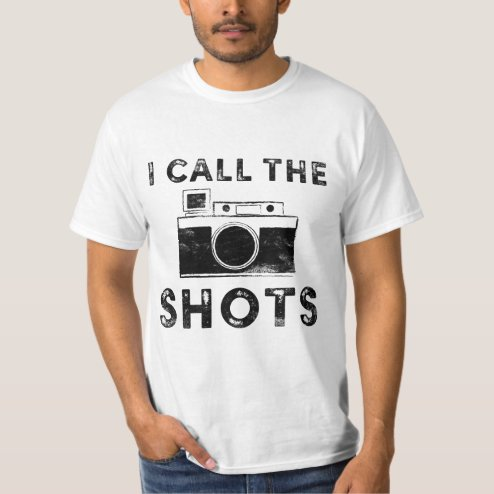

# DLS-ZZ-006 — I call the shots Black Distressed Design T-Shirt

Status: collected front-design reference; back unverified. No family synthesis.

- Product: https://www.zazzle.com/i_call_the_shots_black_distressed_design_t_shirt-235274331790750034
- Marketplace: Zazzle. Individual creator not exposed in captured collection card; attribution unresolved.
- Discovery: https://www.zazzle.com/c/mens+tshirts; ZZ-men, page 1, product position 8; **Popular** selected, 2026-10-20. Default Safe content filter. Ads excluded from product numbering.
- Commercial signal: marketplace Popular order, not audited sales, a disclosed sales window, or proof that visual treatment caused demand.
- Source image: https://rlv.zcache.com/i_call_the_shots_black_distressed_design_t_shirt-rc5e6e34ca5d6407dbba7f80c49c8aa04_jyr6t_494.jpg
- SHA-256: `98b3a6fd03796810a50867def01a5df2277cc4cbf89becb652e81972210b4bf6`. Retained displayed CDN image, unedited. Promotional mockup, not a physical sample.
- Eligibility: adult tee; complete predefined front design; no observed licensed character or celebrity. Back unverified. Optional editing alone is not exclusion; placeholder-dependent templates excluded.
- Garment: visible color/cut described below. Fiber, physical print dimensions and ink method unverified; estimates from mockups only.
- Deduplication: recolors of the same artwork not separately counted; global cross-source reconciliation pending.

## Visual observation

White crew-neck with black centered chest artwork. Large retro camera forms middle line between arched uppercase I CALL THE and heavy SHOTS below. Camera and block lettering share distressed texture and comparable visual width; shirt white supplies both background and internal camera highlights. Compact three-tier emblem makes photography association explicit.

## Limits

No exact font identification, buyer-demographic inference, family assignment or causal sales claim. Source-image resolution and model pose limit proportions. Brand, subject, gifting and promotional presentation can affect appeal independently of design language.
