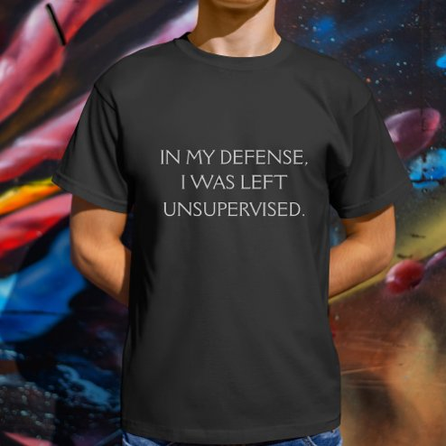

# DLS-ZZ-007 — Funny Excuse Quote Tri-Blend Shirt

Status: collected front-design reference; back unverified. No family synthesis.

- Product: https://www.zazzle.com/funny_excuse_quote_tri_blend_shirt-235833727324399977
- Marketplace: Zazzle. Individual creator not exposed in captured collection card; attribution unresolved.
- Discovery: https://www.zazzle.com/c/mens+tshirts; ZZ-men, page 1, product position 10; **Popular** selected, 2026-10-20. Default Safe content filter. Ads excluded from product numbering.
- Commercial signal: marketplace Popular order, not audited sales, a disclosed sales window, or proof that visual treatment caused demand.
- Source image: https://rlv.zcache.com/funny_excuse_quote_tri_blend_shirt-r_v4g7rb_494.jpg
- SHA-256: `f211eeaa23f42b4d717a6a5829bafc00a83e7ca75d3fe8b39fb61fb92cfa2402`. Retained displayed CDN image, unedited. Promotional mockup, not a physical sample.
- Eligibility: adult tee; complete predefined front design; no observed licensed character or celebrity. Back unverified. Optional editing alone is not exclusion; placeholder-dependent templates excluded.
- Garment: visible color/cut described below. Fiber, physical print dimensions and ink method unverified; estimates from mockups only.
- Deduplication: recolors of the same artwork not separately counted; global cross-source reconciliation pending.

## Visual observation

Black tri-blend listing shown on model; small centered three-line pale thin uppercase copy. Even-weight sans-serif letters and generous surrounding black make a quiet chest statement. No illustration, enclosure or distress. Galaxy imagery belongs to mockup backdrop, not print; composition depends entirely on readable wording.

## Limits

No exact font identification, buyer-demographic inference, family assignment or causal sales claim. Source-image resolution and model pose limit proportions. Brand, subject, gifting and promotional presentation can affect appeal independently of design language.
