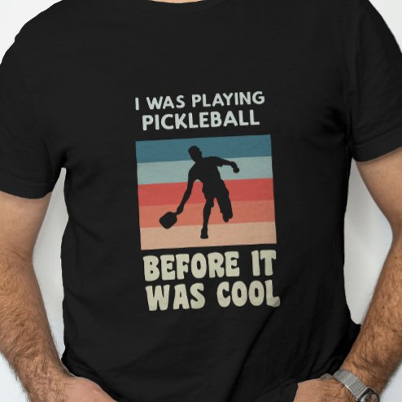

# DLS-ZZ-010 — I Was Playing Pickleball Before It Was Cool T-Shirt

Status: collected front-design reference; back unverified. No family synthesis.

- Product: https://www.zazzle.com/i_was_playing_pickleball_before_it_was_cool_t_shirt-256598705485276007
- Marketplace: Zazzle. Individual creator not exposed in captured collection card; attribution unresolved.
- Discovery: https://www.zazzle.com/c/mens+tshirts; ZZ-men, page 1, product position 21; **Popular** selected, 2026-10-20. Default Safe content filter. Ads excluded from product numbering.
- Commercial signal: marketplace Popular order, not audited sales, a disclosed sales window, or proof that visual treatment caused demand.
- Source image: https://rlv.zcache.com/i_was_playing_pickleball_before_it_was_cool_t_shirt-r_v4n9ex_494.jpg
- SHA-256: `7c2fc28275ec277320ca7dba264ff55e439e2d1d31e22d9c53c12a696442efc2`. Retained displayed CDN image, unedited. Promotional mockup, not a physical sample.
- Eligibility: adult tee; complete predefined front design; no observed licensed character or celebrity. Back unverified. Optional editing alone is not exclusion; placeholder-dependent templates excluded.
- Garment: visible color/cut described below. Fiber, physical print dimensions and ink method unverified; estimates from mockups only.
- Deduplication: recolors of the same artwork not separately counted; global cross-source reconciliation pending.

## Visual observation

Black crew-neck with medium chest print: small two-line uppercase setup, central rectangular retro stripe sunset with black pickleball player silhouette, larger two-line ending below. Muted teal, coral and cream stripes provide color; pale copy contrasts black shirt. Image and concluding copy have more weight than opening.

## Limits

No exact font identification, buyer-demographic inference, family assignment or causal sales claim. Source-image resolution and model pose limit proportions. Brand, subject, gifting and promotional presentation can affect appeal independently of design language.
