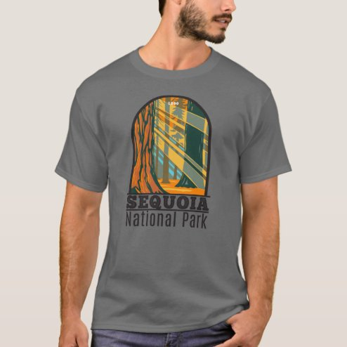

# DLS-ZZ-011 — Sequoia National Park Giant Sequoia Trees T-Shirt

Status: collected front-design reference; back unverified. No family synthesis.

- Product: https://www.zazzle.com/sequoia_national_park_giant_sequoia_trees_t_shirt-235839438748720147
- Marketplace: Zazzle. Individual creator not exposed in captured collection card; attribution unresolved.
- Discovery: https://www.zazzle.com/c/mens+tshirts; ZZ-men, page 1, product position 23; **Popular** selected, 2026-10-20. Default Safe content filter. Ads excluded from product numbering.
- Commercial signal: marketplace Popular order, not audited sales, a disclosed sales window, or proof that visual treatment caused demand.
- Source image: https://rlv.zcache.com/sequoia_national_park_giant_sequoia_trees_t_shirt-r857173bfb5844dd698da9f24704b6b7f_k218b_494.jpg
- SHA-256: `786d2c616af3cad8a0cfa1e702660c8f0ba6c781e19043559593c7cbb1ab4b33`. Retained displayed CDN image, unedited. Promotional mockup, not a physical sample.
- Eligibility: adult tee; complete predefined front design; no observed licensed character or celebrity. Back unverified. Optional editing alone is not exclusion; placeholder-dependent templates excluded.
- Garment: visible color/cut described below. Fiber, physical print dimensions and ink method unverified; estimates from mockups only.
- Deduplication: recolors of the same artwork not separately counted; global cross-source reconciliation pending.

## Visual observation

Gray crew-neck; centered medium vertical park emblem. Rounded arch contains tall trees rendered in ochre, muted green and dark lines with a striped geometric light pattern. Condensed dark park name stacked immediately beneath. Illustration dominates, type acts as compact identification; no enclosing rectangle outside arch.

## Limits

No exact font identification, buyer-demographic inference, family assignment or causal sales claim. Source-image resolution and model pose limit proportions. Brand, subject, gifting and promotional presentation can affect appeal independently of design language.
