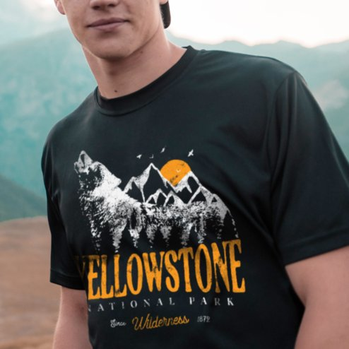

# DLS-ZZ-013 — Yellowstone National Park Wolf Mountains Vintage T-Shirt

Status: collected front-design reference; back unverified. No family synthesis.

- Product: https://www.zazzle.com/yellowstone_national_park_wolf_mountains_vintage_t_shirt-235656662341811674
- Marketplace: Zazzle. Individual creator not exposed in captured collection card; attribution unresolved.
- Discovery: https://www.zazzle.com/c/mens+tshirts; ZZ-men, page 1, product position 26; **Popular** selected, 2026-10-20. Default Safe content filter. Ads excluded from product numbering.
- Commercial signal: marketplace Popular order, not audited sales, a disclosed sales window, or proof that visual treatment caused demand.
- Source image: https://rlv.zcache.com/yellowstone_national_park_wolf_mountains_vintage_t_shirt-r_vshadz_494.jpg
- SHA-256: `39252a23332e2c7294f7ea84a81d77a59da5d4d11a383df8619797f163820abd`. Retained displayed CDN image, unedited. Promotional mockup, not a physical sample.
- Eligibility: adult tee; complete predefined front design; no observed licensed character or celebrity. Back unverified. Optional editing alone is not exclusion; placeholder-dependent templates excluded.
- Garment: visible color/cut described below. Fiber, physical print dimensions and ink method unverified; estimates from mockups only.
- Deduplication: recolors of the same artwork not separately counted; global cross-source reconciliation pending.

## Visual observation

Very dark forest/navy crew-neck in cropped lifestyle photo. Broad centered white mountain-and-wolf illustration with orange sun accent; large distressed ochre YELLOWSTONE below and small widely spaced park/location lines. Tall detailed silhouette fades into shirt rather than hard rectangle; photo crop limits total print-height estimate.

## Limits

No exact font identification, buyer-demographic inference, family assignment or causal sales claim. Source-image resolution and model pose limit proportions. Brand, subject, gifting and promotional presentation can affect appeal independently of design language.
