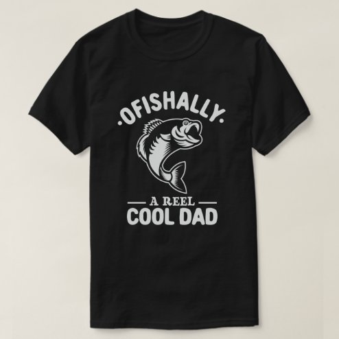

# DLS-ZZ-014 — Ofishally A Reel Cool Dad Funny Fishing Lover T-Shirt

Status: collected front-design reference; back unverified. No family synthesis.

- Product: https://www.zazzle.com/ofishally_a_reel_cool_dad_funny_fishing_lover_t_shirt-235894819726365349
- Marketplace: Zazzle. Individual creator not exposed in captured collection card; attribution unresolved.
- Discovery: https://www.zazzle.com/c/mens+tshirts; ZZ-men, page 1, product position 27; **Popular** selected, 2026-10-20. Default Safe content filter. Ads excluded from product numbering.
- Commercial signal: marketplace Popular order, not audited sales, a disclosed sales window, or proof that visual treatment caused demand.
- Source image: https://rlv.zcache.com/ofishally_a_reel_cool_dad_funny_fishing_lover_t_shirt-r764f6ed345984a6aa5f0c3890c18429c_jgsdi_494.jpg
- SHA-256: `f6cf45c3d82df903d44627b3d649d75158a8f9ee2de684190e3a9213053376d6`. Retained displayed CDN image, unedited. Promotional mockup, not a physical sample.
- Eligibility: adult tee; complete predefined front design; no observed licensed character or celebrity. Back unverified. Optional editing alone is not exclusion; placeholder-dependent templates excluded.
- Garment: visible color/cut described below. Fiber, physical print dimensions and ink method unverified; estimates from mockups only.
- Deduplication: recolors of the same artwork not separately counted; global cross-source reconciliation pending.

## Visual observation

Black flat-laid crew-neck. White arched OFISHALLY above curved fish illustration; small A REEL and bold COOL DAD below. Single-color linework gives fish internal detail while black shirt supplies negative space. Balanced compact centered chest emblem, gifting/wordplay association carried jointly by image and type.

## Limits

No exact font identification, buyer-demographic inference, family assignment or causal sales claim. Source-image resolution and model pose limit proportions. Brand, subject, gifting and promotional presentation can affect appeal independently of design language.
