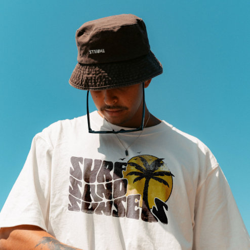

# DLS-ZZ-016 — Retro Surf Sand Sunsets Palm Tree Beach Vibes T-Shirt

Status: collected front-design reference; back unverified. No family synthesis.

- Product: https://www.zazzle.com/retro_surf_sand_sunsets_palm_tree_beach_vibes_t_shirt-256848094081482843
- Marketplace: Zazzle. Individual creator not exposed in captured collection card; attribution unresolved.
- Discovery: https://www.zazzle.com/c/mens+tshirts; ZZ-men, page 1, product position 30; **Popular** selected, 2026-10-20. Default Safe content filter. Ads excluded from product numbering.
- Commercial signal: marketplace Popular order, not audited sales, a disclosed sales window, or proof that visual treatment caused demand.
- Source image: https://rlv.zcache.com/retro_surf_sand_sunsets_palm_tree_beach_vibes_t_shirt-r_ajkdia_494.jpg
- SHA-256: `ee581bc022de839e6373b4016b3eac61c653909012fd9b4d98822607137e2250`. Retained displayed CDN image, unedited. Promotional mockup, not a physical sample.
- Eligibility: adult tee; complete predefined front design; no observed licensed character or celebrity. Back unverified. Optional editing alone is not exclusion; placeholder-dependent templates excluded.
- Garment: visible color/cut described below. Fiber, physical print dimensions and ink method unverified; estimates from mockups only.
- Deduplication: recolors of the same artwork not separately counted; global cross-source reconciliation pending.

## Visual observation

White roomy crew-neck with large dark retro serif stacked words and mustard-yellow sun/palm illustration at right. Letters bend and pack tightly into an irregular chest block; silhouetted palm overlaps circle and type. Dense lower-left lettering balances round upper-right illustration. Lifestyle crop obscures lower hem; no precise width estimate.

## Limits

No exact font identification, buyer-demographic inference, family assignment or causal sales claim. Source-image resolution and model pose limit proportions. Brand, subject, gifting and promotional presentation can affect appeal independently of design language.
