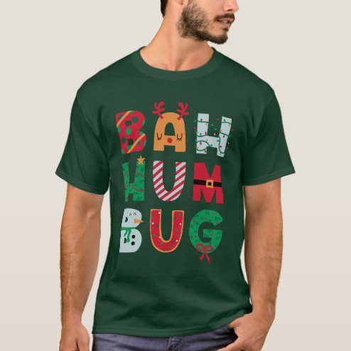

# DLS-ZZ-017 — Funny Bah Humbug Holiday T-Shirt

Status: collected front-design reference; back unverified. No family synthesis.

- Product: https://www.zazzle.com/funny_bah_humbug_holiday_t_shirt-235881064575292561
- Marketplace: Zazzle. Individual creator not exposed in captured collection card; attribution unresolved.
- Discovery: https://www.zazzle.com/c/mens+tshirts; ZZ-men, page 1, product position 31; **Popular** selected, 2026-10-20. Default Safe content filter. Ads excluded from product numbering.
- Commercial signal: marketplace Popular order, not audited sales, a disclosed sales window, or proof that visual treatment caused demand.
- Source image: https://rlv.zcache.com/funny_bah_humbug_holiday_t_shirt-r3963ec38b1ae4c58a717eb938040dd7d_k2gna_494.jpg
- SHA-256: `4b3380332cad43746c4b8fc15125c3f7049a898bfcdd7a37b2aa560256bf503a`. Retained displayed CDN image, unedited. Promotional mockup, not a physical sample.
- Eligibility: adult tee; complete predefined front design; no observed licensed character or celebrity. Back unverified. Optional editing alone is not exclusion; placeholder-dependent templates excluded.
- Garment: visible color/cut described below. Fiber, physical print dimensions and ink method unverified; estimates from mockups only.
- Deduplication: recolors of the same artwork not separately counted; global cross-source reconciliation pending.

## Visual observation

Forest-green crew-neck with broad multicolor stacked BAH HUM BUG lettering. Individual chunky letters contain small seasonal patterns/icons; red, pale blue and off-white contrast garment. Three-by-three grid-like arrangement with irregular letterforms and playful decorations. No separate dominant illustration; glyphs themselves become graphic.

## Limits

No exact font identification, buyer-demographic inference, family assignment or causal sales claim. Source-image resolution and model pose limit proportions. Brand, subject, gifting and promotional presentation can affect appeal independently of design language.
