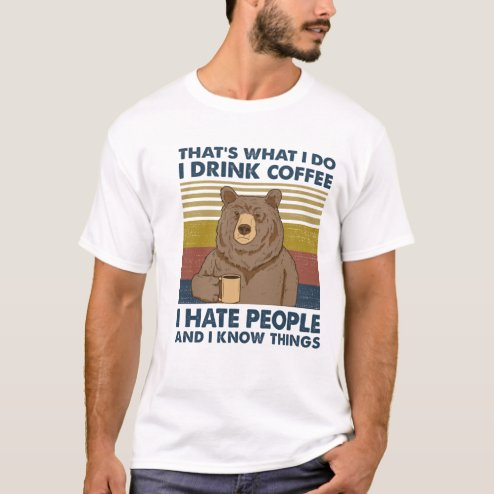

# DLS-ZZ-018 — I drink coffee I hate people and I know things T-Shirt

Status: collected front-design reference; back unverified. No family synthesis.

- Product: https://www.zazzle.com/i_drink_coffee_i_hate_people_and_i_know_things_t_shirt-235534459741354915
- Marketplace: Zazzle. Individual creator not exposed in captured collection card; attribution unresolved.
- Discovery: https://www.zazzle.com/c/mens+tshirts; ZZ-men, page 1, product position 32; **Popular** selected, 2026-10-20. Default Safe content filter. Ads excluded from product numbering.
- Commercial signal: marketplace Popular order, not audited sales, a disclosed sales window, or proof that visual treatment caused demand.
- Source image: https://rlv.zcache.com/i_drink_coffee_i_hate_people_and_i_know_things_t_shirt-rb3eb0728968045099b0f597684f2c008_k2gr0_494.jpg
- SHA-256: `b02a0a44c13a3cfa8dab5b3b0f9504dd81c60cff0f6112ab0b36e7362626052f`. Retained displayed CDN image, unedited. Promotional mockup, not a physical sample.
- Eligibility: adult tee; complete predefined front design; no observed licensed character or celebrity. Back unverified. Optional editing alone is not exclusion; placeholder-dependent templates excluded.
- Garment: visible color/cut described below. Fiber, physical print dimensions and ink method unverified; estimates from mockups only.
- Deduplication: recolors of the same artwork not separately counted; global cross-source reconciliation pending.

## Visual observation

White crew-neck with broad rectangular graphic. Black uppercase setup over retro horizontal ochre stripes and a brown bear holding coffee; bold black concluding lines underneath. Striped block and bear supply visual center, dense text closes bottom. Complete generic phrase design; quotation/cultural familiarity may influence appeal.

## Limits

No exact font identification, buyer-demographic inference, family assignment or causal sales claim. Source-image resolution and model pose limit proportions. Brand, subject, gifting and promotional presentation can affect appeal independently of design language.
