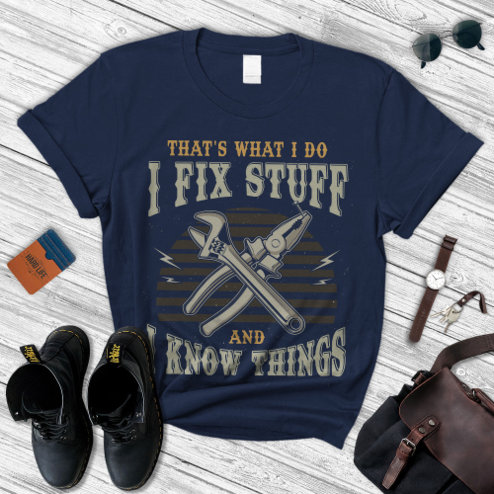

# DLS-ZZ-020 — I Fix Stuff And Know Things Shirt, Gift For Men's  T-Shirt

Status: collected front-design reference; back unverified. No family synthesis.

- Product: https://www.zazzle.com/i_fix_stuff_and_know_things_shirt_gift_for_mens_t_shirt-256900883567467412
- Marketplace: Zazzle. Individual creator not exposed in captured collection card; attribution unresolved.
- Discovery: https://www.zazzle.com/c/mens+tshirts; ZZ-men, page 1, product position 39; **Popular** selected, 2026-10-20. Default Safe content filter. Ads excluded from product numbering.
- Commercial signal: marketplace Popular order, not audited sales, a disclosed sales window, or proof that visual treatment caused demand.
- Source image: https://rlv.zcache.com/i_fix_stuff_and_know_things_shirt_gift_for_mens_t_shirt-r_n7ywh_494.jpg
- SHA-256: `a5d8977f5b4e82f800856a92d2404a385e7b54e748974153b9a5a1e6fdbe4cae`. Retained displayed CDN image, unedited. Promotional mockup, not a physical sample.
- Eligibility: adult tee; complete predefined front design; no observed licensed character or celebrity. Back unverified. Optional editing alone is not exclusion; placeholder-dependent templates excluded.
- Garment: visible color/cut described below. Fiber, physical print dimensions and ink method unverified; estimates from mockups only.
- Deduplication: recolors of the same artwork not separately counted; global cross-source reconciliation pending.

## Visual observation

Navy flat-laid crew-neck with large vertical vintage-workshop print. Ornamental slab-serif I FIX STUFF dominates top; crossed wrench/pliers central over subdued horizontal stripes and tiny lightning bolts. KNOW THINGS curves across bottom; smaller connector lines fill gaps. Muted khaki and ochre, distressed texture and integrated tool silhouettes establish repair identity. Props around shirt are not print.

## Limits

No exact font identification, buyer-demographic inference, family assignment or causal sales claim. Source-image resolution and model pose limit proportions. Brand, subject, gifting and promotional presentation can affect appeal independently of design language.
