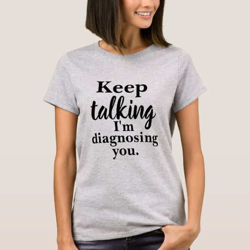

# DLS-ZZ-023 — Keep Talking I'm Diagnosing You T-Shirt

Status: collected front-design reference; back unverified. No family synthesis.

- Product: https://www.zazzle.com/keep_talking_im_diagnosing_you_t_shirt-235456070308677954
- Marketplace: Zazzle. Individual creator not exposed in captured collection card; attribution unresolved.
- Discovery: https://www.zazzle.com/c/womens%2Btshirts; ZZ-women, page 1, product position 4; **Popular** selected, 2026-10-20. Default Safe content filter. Ads excluded from product numbering.
- Commercial signal: marketplace Popular order, not audited sales, a disclosed sales window, or proof that visual treatment caused demand.
- Source image: https://rlv.zcache.com/keep_talking_im_diagnosing_you_t_shirt-r3497d2998d0846a4acc988296031be80_k212r_494.jpg
- SHA-256: `6d5f8d7dbd9edc1fcb1da511eb5820450427e51741649a6777f31fb7216b87f1`. Retained displayed CDN image, unedited. Promotional mockup, not a physical sample.
- Eligibility: adult tee; complete predefined front design; no observed licensed character or celebrity. Back unverified. Optional editing alone is not exclusion; placeholder-dependent templates excluded.
- Garment: visible color/cut described below. Fiber, physical print dimensions and ink method unverified; estimates from mockups only.
- Deduplication: recolors of the same artwork not separately counted; global cross-source reconciliation pending.

## Visual observation

Light heather-gray crew-neck. Narrow centered black type stack; Keep and diagnosis lines in bold serif, talking enlarged in flowing script. Five short lines produce a compact vertical shape with uneven type sizes and deliberate emphasis. No image; medium print scale and clear garment margin.

## Limits

No exact font identification, buyer-demographic inference, family assignment or causal sales claim. Source-image resolution and model pose limit proportions. Brand, subject, gifting and promotional presentation can affect appeal independently of design language.
