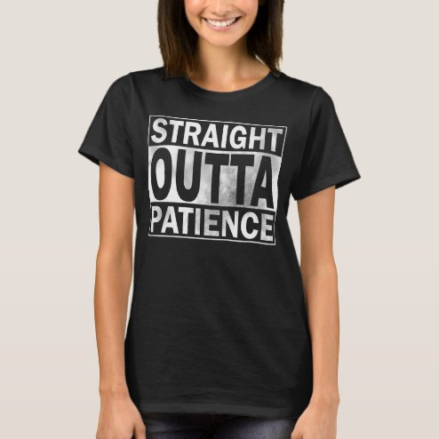

# DLS-ZZ-024 — Funny T-Shirt, Straight Outta Patience T-Shirt

Status: collected front-design reference; back unverified. No family synthesis.

- Product: https://www.zazzle.com/funny_t_shirt_straight_outta_patience_t_shirt-235226176704239643
- Marketplace: Zazzle. Individual creator not exposed in captured collection card; attribution unresolved.
- Discovery: https://www.zazzle.com/c/womens%2Btshirts; ZZ-women, page 1, product position 5; **Popular** selected, 2026-10-20. Default Safe content filter. Ads excluded from product numbering.
- Commercial signal: marketplace Popular order, not audited sales, a disclosed sales window, or proof that visual treatment caused demand.
- Source image: https://rlv.zcache.com/funny_t_shirt_straight_outta_patience_t_shirt-r9349ba1922e84e5c9f97330e20f50897_k2grj_494.jpg
- SHA-256: `dc6ab6bc268e911ace8cac5d842398822a1b5b5fdbe40a713fd29cf6764a19f4`. Retained displayed CDN image, unedited. Promotional mockup, not a physical sample.
- Eligibility: adult tee; complete predefined front design; no observed licensed character or celebrity. Back unverified. Optional editing alone is not exclusion; placeholder-dependent templates excluded.
- Garment: visible color/cut described below. Fiber, physical print dimensions and ink method unverified; estimates from mockups only.
- Deduplication: recolors of the same artwork not separately counted; global cross-source reconciliation pending.

## Visual observation

Black regular crew-neck with centered white rectangular label. STRAIGHT and PATIENCE occupy smaller top/bottom bands; oversized condensed OUTTA fills middle. Hard white rules enclose tightly stacked bold capitals; distressed gray-white texture. Cultural format allusion retained without character imagery; wording is complete, not a placeholder.

## Limits

No exact font identification, buyer-demographic inference, family assignment or causal sales claim. Source-image resolution and model pose limit proportions. Brand, subject, gifting and promotional presentation can affect appeal independently of design language.
