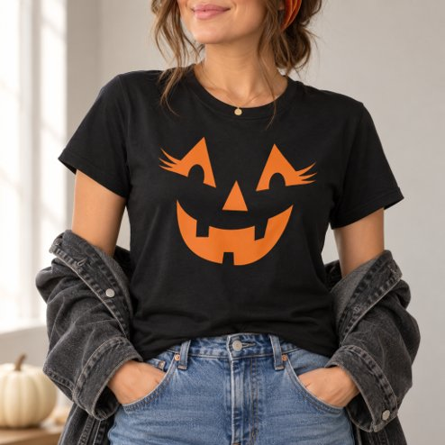

# DLS-ZZ-026 — Girly Jack O Lantern Face Womens Halloween T-Shirt

Status: collected front-design reference; back unverified. No family synthesis.

- Product: https://www.zazzle.com/girly_jack_o_lantern_face_womens_halloween_t_shirt-235564136074470400
- Marketplace: Zazzle. Individual creator not exposed in captured collection card; attribution unresolved.
- Discovery: https://www.zazzle.com/c/womens%2Btshirts; ZZ-women, page 1, product position 7; **Popular** selected, 2026-10-20. Default Safe content filter. Ads excluded from product numbering.
- Commercial signal: marketplace Popular order, not audited sales, a disclosed sales window, or proof that visual treatment caused demand.
- Source image: https://rlv.zcache.com/girly_jack_o_lantern_face_womens_halloween_t_shirt-r_kvbm4x_494.jpg
- SHA-256: `4603248e84587912f848d90e141eb549e07af4d8323154935113d947f64ccee5`. Retained displayed CDN image, unedited. Promotional mockup, not a physical sample.
- Eligibility: adult tee; complete predefined front design; no observed licensed character or celebrity. Back unverified. Optional editing alone is not exclusion; placeholder-dependent templates excluded.
- Garment: visible color/cut described below. Fiber, physical print dimensions and ink method unverified; estimates from mockups only.
- Deduplication: recolors of the same artwork not separately counted; global cross-source reconciliation pending.

## Visual observation

Black crew-neck with large orange jack-o-lantern face, no enclosing pumpkin outline or copy. Triangular eyes have long eyelash extensions; angular nose and wide toothy smile are floating shapes. Shirt black becomes the pumpkin's face/background. Broad simple graphic reads at distance with one vivid color.

## Limits

No exact font identification, buyer-demographic inference, family assignment or causal sales claim. Source-image resolution and model pose limit proportions. Brand, subject, gifting and promotional presentation can affect appeal independently of design language.
