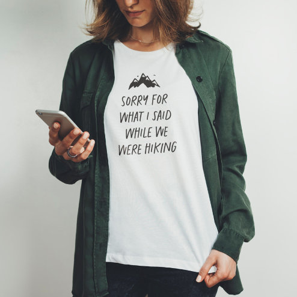

# DLS-ZZ-027 — Sorry for what I said while we were hiking funny T-Shirt

Status: collected front-design reference; back unverified. No family synthesis.

- Product: https://www.zazzle.com/sorry_for_what_i_said_while_we_were_hiking_funny_t_shirt-235582387378746354
- Marketplace: Zazzle. Individual creator not exposed in captured collection card; attribution unresolved.
- Discovery: https://www.zazzle.com/c/womens%2Btshirts; ZZ-women, page 1, product position 8; **Popular** selected, 2026-10-20. Default Safe content filter. Ads excluded from product numbering.
- Commercial signal: marketplace Popular order, not audited sales, a disclosed sales window, or proof that visual treatment caused demand.
- Source image: https://rlv.zcache.com/sorry_for_what_i_said_while_we_were_hiking_funny_t_shirt-r_dr2x5_494.jpg
- SHA-256: `838134653be0ba3909bd5ef2f03bd0721e76686cc4c745b0f03c3496c9710ec8`. Retained displayed CDN image, unedited. Promotional mockup, not a physical sample.
- Eligibility: adult tee; complete predefined front design; no observed licensed character or celebrity. Back unverified. Optional editing alone is not exclusion; placeholder-dependent templates excluded.
- Garment: visible color/cut described below. Fiber, physical print dimensions and ink method unverified; estimates from mockups only.
- Deduplication: recolors of the same artwork not separately counted; global cross-source reconciliation pending.

## Visual observation

White crew-neck layered under open dark overshirt. Small black mountain silhouette above five narrow lines of handwritten uppercase hiking apology. Compact vertical chest composition, illustration subordinate to text; abundant white margins. Outer garment is styling context, not part of offered print.

## Limits

No exact font identification, buyer-demographic inference, family assignment or causal sales claim. Source-image resolution and model pose limit proportions. Brand, subject, gifting and promotional presentation can affect appeal independently of design language.
