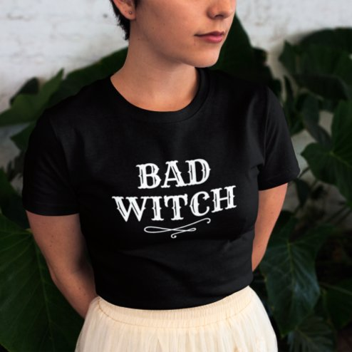

# DLS-ZZ-028 — Bad Witch Vintage White Type Womens Halloween T-Shirt

Status: collected front-design reference; back unverified. No family synthesis.

- Product: https://www.zazzle.com/bad_witch_vintage_white_type_womens_halloween_t_shirt-235856174563064101
- Marketplace: Zazzle. Individual creator not exposed in captured collection card; attribution unresolved.
- Discovery: https://www.zazzle.com/c/womens%2Btshirts; ZZ-women, page 1, product position 9; **Popular** selected, 2026-10-20. Default Safe content filter. Ads excluded from product numbering.
- Commercial signal: marketplace Popular order, not audited sales, a disclosed sales window, or proof that visual treatment caused demand.
- Source image: https://rlv.zcache.com/bad_witch_vintage_white_type_womens_halloween_t_shirt-r_vs8g2e_494.jpg
- SHA-256: `bbd94be057286497f38cbf1597b17a856f45dcbe14c092bd9d0ae0018a055b7f`. Retained displayed CDN image, unedited. Promotional mockup, not a physical sample.
- Eligibility: adult tee; complete predefined front design; no observed licensed character or celebrity. Back unverified. Optional editing alone is not exclusion; placeholder-dependent templates excluded.
- Garment: visible color/cut described below. Fiber, physical print dimensions and ink method unverified; estimates from mockups only.
- Deduplication: recolors of the same artwork not separately counted; global cross-source reconciliation pending.

## Visual observation

Black fitted-looking crew-neck with compact white BAD WITCH in two distressed serif-capital lines and curling flourish below. Matching visual template to Good Witch reference, different text and inverse color. Medium upper-chest placement and large black margins; keep this variation visible rather than claiming a new visual family.

## Limits

No exact font identification, buyer-demographic inference, family assignment or causal sales claim. Source-image resolution and model pose limit proportions. Brand, subject, gifting and promotional presentation can affect appeal independently of design language.
