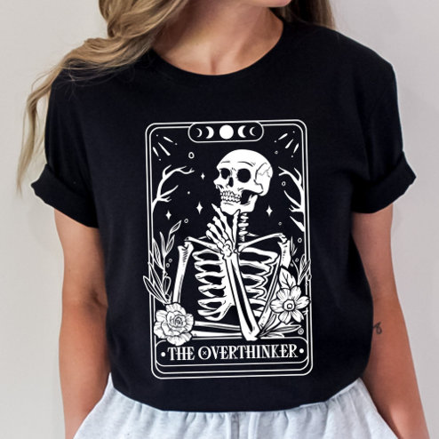

# DLS-ZZ-029 — The Overthinker Tarot Skeleton T-Shirt

Status: collected front-design reference; back unverified. No family synthesis.

- Product: https://www.zazzle.com/the_overthinker_tarot_skeleton_t_shirt-256445344356044235
- Marketplace: Zazzle. Individual creator not exposed in captured collection card; attribution unresolved.
- Discovery: https://www.zazzle.com/c/womens%2Btshirts; ZZ-women, page 1, product position 11; **Popular** selected, 2026-10-20. Default Safe content filter. Ads excluded from product numbering.
- Commercial signal: marketplace Popular order, not audited sales, a disclosed sales window, or proof that visual treatment caused demand.
- Source image: https://rlv.zcache.com/the_overthinker_tarot_skeleton_t_shirt-r_vfv7km_494.jpg
- SHA-256: `331d6025821f49eff478d884635333f8c556d86f2cc4dab8e5ca93db683e9a84`. Retained displayed CDN image, unedited. Promotional mockup, not a physical sample.
- Eligibility: adult tee; complete predefined front design; no observed licensed character or celebrity. Back unverified. Optional editing alone is not exclusion; placeholder-dependent templates excluded.
- Garment: visible color/cut described below. Fiber, physical print dimensions and ink method unverified; estimates from mockups only.
- Deduplication: recolors of the same artwork not separately counted; global cross-source reconciliation pending.

## Visual observation

Black crew-neck with large tall cream tarot-card rectangle. Fine double-line border surrounds contemplative skeleton, botanical sprigs, stars and moon phases. Small bottom title THE OVERTHINKER, image dominant. High-detail linework and garment black supply interior shadows; strong rectangular silhouette covers much of torso.

## Limits

No exact font identification, buyer-demographic inference, family assignment or causal sales claim. Source-image resolution and model pose limit proportions. Brand, subject, gifting and promotional presentation can affect appeal independently of design language.
