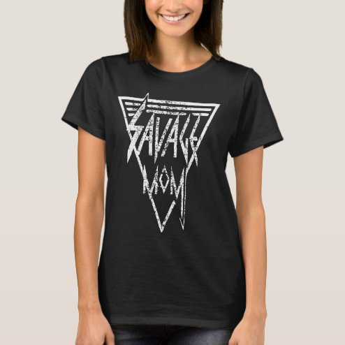

# DLS-ZZ-032 — Savage mom,funny women T-Shirt

Status: collected front-design reference; back unverified. No family synthesis.

- Product: https://www.zazzle.com/savage_mom_funny_women_t_shirt-235114527282996680
- Marketplace: Zazzle. Individual creator not exposed in captured collection card; attribution unresolved.
- Discovery: https://www.zazzle.com/c/womens%2Btshirts; ZZ-women, page 1, product position 16; **Popular** selected, 2026-10-20. Default Safe content filter. Ads excluded from product numbering.
- Commercial signal: marketplace Popular order, not audited sales, a disclosed sales window, or proof that visual treatment caused demand.
- Source image: https://rlv.zcache.com/savage_mom_funny_women_t_shirt-raf2258215d6c45f1876b13f39c12895f_k2grj_494.jpg
- SHA-256: `a51b7b77651edf2854fcfdce08de820add2ea7166356e5d764869f124b2c4c69`. Retained displayed CDN image, unedited. Promotional mockup, not a physical sample.
- Eligibility: adult tee; complete predefined front design; no observed licensed character or celebrity. Back unverified. Optional editing alone is not exclusion; placeholder-dependent templates excluded.
- Garment: visible color/cut described below. Fiber, physical print dimensions and ink method unverified; estimates from mockups only.
- Deduplication: recolors of the same artwork not separately counted; global cross-source reconciliation pending.

## Visual observation

Black crew-neck with medium white elongated triangular emblem. Sharp angular SAVAGE MOM lettering stacks into an inverted triangle with thin double outlines and speed-line accents. Distressed marks, pointed glyphs and diagonal edges supply energetic rock-like treatment; no pictorial subject.

## Limits

No exact font identification, buyer-demographic inference, family assignment or causal sales claim. Source-image resolution and model pose limit proportions. Brand, subject, gifting and promotional presentation can affect appeal independently of design language.
