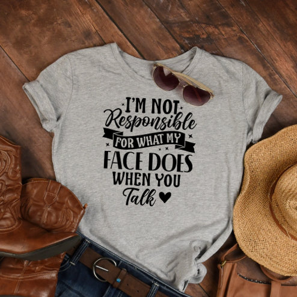

# DLS-ZZ-033 — Not Responsible Funny Sarcastic Offensive T-Shirt

Status: collected front-design reference; back unverified. No family synthesis.

- Product: https://www.zazzle.com/not_responsible_funny_sarcastic_offensive_t_shirt-235317357297314117
- Marketplace: Zazzle. Individual creator not exposed in captured collection card; attribution unresolved.
- Discovery: https://www.zazzle.com/c/womens%2Btshirts; ZZ-women, page 1, product position 17; **Popular** selected, 2026-10-20. Default Safe content filter. Ads excluded from product numbering.
- Commercial signal: marketplace Popular order, not audited sales, a disclosed sales window, or proof that visual treatment caused demand.
- Source image: https://rlv.zcache.com/not_responsible_funny_sarcastic_offensive_t_shirt-r_d9v4c_494.jpg
- SHA-256: `5d77ef9ae6a7509a06ef6c755f85a68fbd39e4d5f0c441cf852248ffa07f9222`. Retained displayed CDN image, unedited. Promotional mockup, not a physical sample.
- Eligibility: adult tee; complete predefined front design; no observed licensed character or celebrity. Back unverified. Optional editing alone is not exclusion; placeholder-dependent templates excluded.
- Garment: visible color/cut described below. Fiber, physical print dimensions and ink method unverified; estimates from mockups only.
- Deduplication: recolors of the same artwork not separately counted; global cross-source reconciliation pending.

## Visual observation

Heather-gray flat-laid crew-neck. Dense black mixed-type statement centered chest: bold condensed capitals alternate with larger brush-script Responsible and Talk. Short bars/ribbon-like separators bind lines into a vertical block. Type-only, no colored accents; folded hem/props are styling rather than design.

## Limits

No exact font identification, buyer-demographic inference, family assignment or causal sales claim. Source-image resolution and model pose limit proportions. Brand, subject, gifting and promotional presentation can affect appeal independently of design language.
