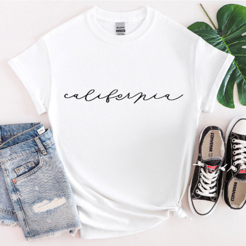

# DLS-ZZ-034 — California Script State Women’s T-Shirt

Status: collected front-design reference; back unverified. No family synthesis.

- Product: https://www.zazzle.com/california_script_state_women_s_t_shirt-235105372182805567
- Marketplace: Zazzle. Individual creator not exposed in captured collection card; attribution unresolved.
- Discovery: https://www.zazzle.com/c/womens%2Btshirts; ZZ-women, page 1, product position 18; **Popular** selected, 2026-10-20. Default Safe content filter. Ads excluded from product numbering.
- Commercial signal: marketplace Popular order, not audited sales, a disclosed sales window, or proof that visual treatment caused demand.
- Source image: https://rlv.zcache.com/california_script_state_women_s_t_shirt-r_rhv9n_494.jpg
- SHA-256: `6841108e73ed215ada1ee0f247ee5a016cc2b987054fb43afc28b1fc975fdb61`. Retained displayed CDN image, unedited. Promotional mockup, not a physical sample.
- Eligibility: adult tee; complete predefined front design; no observed licensed character or celebrity. Back unverified. Optional editing alone is not exclusion; placeholder-dependent templates excluded.
- Garment: visible color/cut described below. Fiber, physical print dimensions and ink method unverified; estimates from mockups only.
- Deduplication: recolors of the same artwork not separately counted; global cross-source reconciliation pending.

## Visual observation

White flat-laid crew-neck with small black california in thin flowing lowercase handwritten script across upper chest. Horizontal word shape, no picture or enclosure, extensive white negative space. Knotted bottom and staged accessories alter garment presentation but do not establish manufacturing cut.

## Limits

No exact font identification, buyer-demographic inference, family assignment or causal sales claim. Source-image resolution and model pose limit proportions. Brand, subject, gifting and promotional presentation can affect appeal independently of design language.
