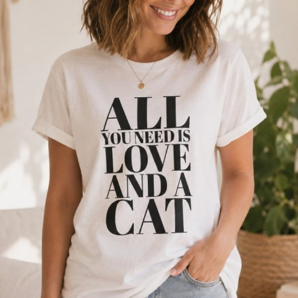

# DLS-ZZ-035 — Cute Quote All You Need Is Love and a Cat T-Shirt

Status: collected front-design reference; back unverified. No family synthesis.

- Product: https://www.zazzle.com/cute_quote_all_you_need_is_love_and_a_cat_t_shirt-235267928359647359
- Marketplace: Zazzle. Individual creator not exposed in captured collection card; attribution unresolved.
- Discovery: https://www.zazzle.com/c/womens%2Btshirts; ZZ-women, page 1, product position 19; **Popular** selected, 2026-10-20. Default Safe content filter. Ads excluded from product numbering.
- Commercial signal: marketplace Popular order, not audited sales, a disclosed sales window, or proof that visual treatment caused demand.
- Source image: https://rlv.zcache.com/cute_quote_all_you_need_is_love_and_a_cat_t_shirt-r_6ltzwk_494.jpg
- SHA-256: `9e3013fe4b1c58073a36d3807f446963b9d4accf0562f25aaf889ce9be9bcf80`. Retained displayed CDN image, unedited. Promotional mockup, not a physical sample.
- Eligibility: adult tee; complete predefined front design; no observed licensed character or celebrity. Back unverified. Optional editing alone is not exclusion; placeholder-dependent templates excluded.
- Garment: visible color/cut described below. Fiber, physical print dimensions and ink method unverified; estimates from mockups only.
- Deduplication: recolors of the same artwork not separately counted; global cross-source reconciliation pending.

## Visual observation

Pale blush/cream crew-neck on model, relaxed-looking fit. Large black condensed high-contrast serif capitals form tall five-line statement; ALL, LOVE and CAT are oversized, YOU NEED IS much smaller. No cat illustration; typography dominates most chest height. Tight leading and centered alignment create a strong vertical shape.

## Limits

No exact font identification, buyer-demographic inference, family assignment or causal sales claim. Source-image resolution and model pose limit proportions. Brand, subject, gifting and promotional presentation can affect appeal independently of design language.
