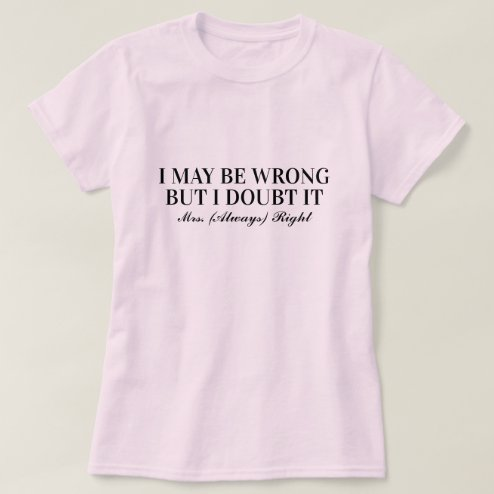

# DLS-ZZ-036 — I may be wrong but i doubt it Mrs Always Right fun T-Shirt

Status: collected front-design reference; back unverified. No family synthesis.

- Product: https://www.zazzle.com/i_may_be_wrong_but_i_doubt_it_mrs_always_right_fun_t_shirt-235772683944030819
- Marketplace: Zazzle. Individual creator not exposed in captured collection card; attribution unresolved.
- Discovery: https://www.zazzle.com/c/womens%2Btshirts; ZZ-women, page 1, product position 21; **Popular** selected, 2026-10-20. Default Safe content filter. Ads excluded from product numbering.
- Commercial signal: marketplace Popular order, not audited sales, a disclosed sales window, or proof that visual treatment caused demand.
- Source image: https://rlv.zcache.com/i_may_be_wrong_but_i_doubt_it_mrs_always_right_fun_t_shirt-r82f43da036714fa3bac5f67e9f16056c_jy5rm_494.jpg
- SHA-256: `4d656d1e5110b00d3c673f0625e9eec673c60f9c6157b84038791a179fe91278`. Retained displayed CDN image, unedited. Promotional mockup, not a physical sample.
- Eligibility: adult tee; complete predefined front design; no observed licensed character or celebrity. Back unverified. Optional editing alone is not exclusion; placeholder-dependent templates excluded.
- Garment: visible color/cut described below. Fiber, physical print dimensions and ink method unverified; estimates from mockups only.
- Deduplication: recolors of the same artwork not separately counted; global cross-source reconciliation pending.

## Visual observation

Pale pink flat-laid regular crew-neck. Small black two-line serif uppercase statement across central chest with much smaller italic/script signoff beneath. Thin strokes, restrained scale, large pale empty area. No illustration or distress; hierarchy separates statement from quiet identity tag.

## Limits

No exact font identification, buyer-demographic inference, family assignment or causal sales claim. Source-image resolution and model pose limit proportions. Brand, subject, gifting and promotional presentation can affect appeal independently of design language.
