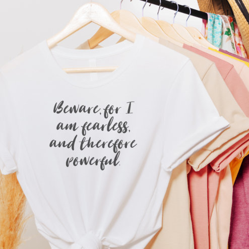

# DLS-ZZ-037 — Fearless Woman Quote in Modern Script Typography T-Shirt

Status: collected front-design reference; back unverified. No family synthesis.

- Product: https://www.zazzle.com/fearless_woman_quote_in_modern_script_typography_t_shirt-235411312973027294
- Marketplace: Zazzle. Individual creator not exposed in captured collection card; attribution unresolved.
- Discovery: https://www.zazzle.com/c/womens%2Btshirts; ZZ-women, page 1, product position 22; **Popular** selected, 2026-10-20. Default Safe content filter. Ads excluded from product numbering.
- Commercial signal: marketplace Popular order, not audited sales, a disclosed sales window, or proof that visual treatment caused demand.
- Source image: https://rlv.zcache.com/fearless_woman_quote_in_modern_script_typography_t_shirt-r_d5cl2_494.jpg
- SHA-256: `a31d124d601a07bcba4b08c1e2e15d6beeb08814234c11b968a1d345c1bdc1c5`. Retained displayed CDN image, unedited. Promotional mockup, not a physical sample.
- Eligibility: adult tee; complete predefined front design; no observed licensed character or celebrity. Back unverified. Optional editing alone is not exclusion; placeholder-dependent templates excluded.
- Garment: visible color/cut described below. Fiber, physical print dimensions and ink method unverified; estimates from mockups only.
- Deduplication: recolors of the same artwork not separately counted; global cross-source reconciliation pending.

## Visual observation

White crew-neck on hanger, knotted hem in lifestyle styling. Medium centered black brush-calligraphy statement in four short lines. Thick/thin strokes and varied baselines create organic rhythm; no image, enclosure or accent color. Styling contributes softness but fabric and actual fitted cut remain unverified.

## Limits

No exact font identification, buyer-demographic inference, family assignment or causal sales claim. Source-image resolution and model pose limit proportions. Brand, subject, gifting and promotional presentation can affect appeal independently of design language.
