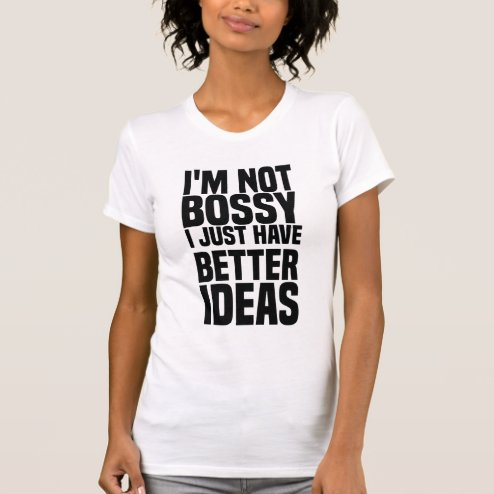

# DLS-ZZ-038 — i'm not bossy i just have better ideas T-Shirt

Status: collected front-design reference; back unverified. No family synthesis.

- Product: https://www.zazzle.com/im_not_bossy_i_just_have_better_ideas_t_shirt-235197774222632415
- Marketplace: Zazzle. Individual creator not exposed in captured collection card; attribution unresolved.
- Discovery: https://www.zazzle.com/c/womens%2Btshirts; ZZ-women, page 1, product position 23; **Popular** selected, 2026-10-20. Default Safe content filter. Ads excluded from product numbering.
- Commercial signal: marketplace Popular order, not audited sales, a disclosed sales window, or proof that visual treatment caused demand.
- Source image: https://rlv.zcache.com/im_not_bossy_i_just_have_better_ideas_t_shirt-r2d766b1648884172aa495003f59ea125_k2glg_494.jpg
- SHA-256: `5e505fc68efe72b0a194b4baa1ae685897ca589d39473203988ae89faf20bbb7`. Retained displayed CDN image, unedited. Promotional mockup, not a physical sample.
- Eligibility: adult tee; complete predefined front design; no observed licensed character or celebrity. Back unverified. Optional editing alone is not exclusion; placeholder-dependent templates excluded.
- Garment: visible color/cut described below. Fiber, physical print dimensions and ink method unverified; estimates from mockups only.
- Deduplication: recolors of the same artwork not separately counted; global cross-source reconciliation pending.

## Visual observation

White crew-neck with large black bold condensed sans-serif stacked statement. I'M NOT and I JUST HAVE are smaller; BOSSY, BETTER and IDEAS expanded. Tight line spacing produces tall dense rectangle with no border or illustration. Semantic emphasis resides in size hierarchy and strong contrast.

## Limits

No exact font identification, buyer-demographic inference, family assignment or causal sales claim. Source-image resolution and model pose limit proportions. Brand, subject, gifting and promotional presentation can affect appeal independently of design language.
