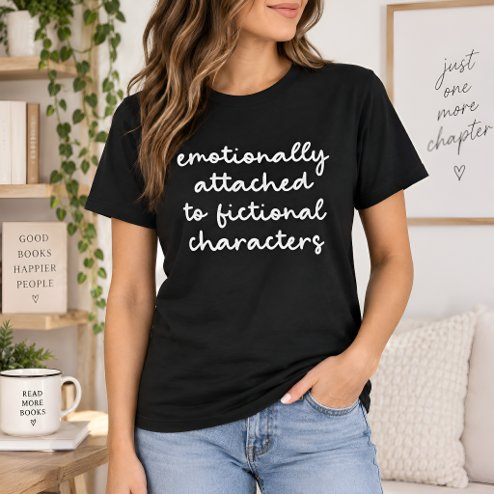

# DLS-ZZ-039 — Funny Quote for Book Lovers Modern Script T-Shirt

Status: collected front-design reference; back unverified. No family synthesis.

- Product: https://www.zazzle.com/funny_quote_for_book_lovers_modern_script_t_shirt-235434137338518147
- Marketplace: Zazzle. Individual creator not exposed in captured collection card; attribution unresolved.
- Discovery: https://www.zazzle.com/c/womens%2Btshirts; ZZ-women, page 1, product position 24; **Popular** selected, 2026-10-20. Default Safe content filter. Ads excluded from product numbering.
- Commercial signal: marketplace Popular order, not audited sales, a disclosed sales window, or proof that visual treatment caused demand.
- Source image: https://rlv.zcache.com/funny_quote_for_book_lovers_modern_script_t_shirt-r_kvam0i_494.jpg
- SHA-256: `8887a861f637c21d797507988935c93870af26555510713445f68a9701950d6d`. Retained displayed CDN image, unedited. Promotional mockup, not a physical sample.
- Eligibility: adult tee; complete predefined front design; no observed licensed character or celebrity. Back unverified. Optional editing alone is not exclusion; placeholder-dependent templates excluded.
- Garment: visible color/cut described below. Fiber, physical print dimensions and ink method unverified; estimates from mockups only.
- Deduplication: recolors of the same artwork not separately counted; global cross-source reconciliation pending.

## Visual observation

Black crew-neck on model. White casual connected script in four centered lines about attachment to fictional characters. Medium chest width, evenly spaced lines, no illustration or border. Rounded handwriting provides soft visual tone despite stark two-color contrast; surrounding black remains open.

## Limits

No exact font identification, buyer-demographic inference, family assignment or causal sales claim. Source-image resolution and model pose limit proportions. Brand, subject, gifting and promotional presentation can affect appeal independently of design language.
