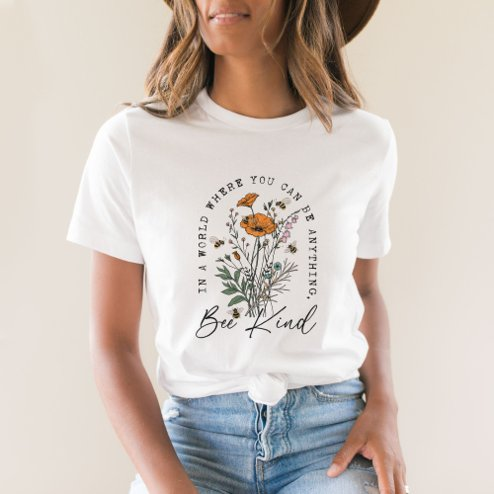

# DLS-ZZ-040 — Vintage Bee and Wild Flowers  T-Shirt

Status: collected front-design reference; back unverified. No family synthesis.

- Product: https://www.zazzle.com/vintage_bee_and_wild_flowers_t_shirt-256385862165696722
- Marketplace: Zazzle. Individual creator not exposed in captured collection card; attribution unresolved.
- Discovery: https://www.zazzle.com/c/womens%2Btshirts; ZZ-women, page 1, product position 25; **Popular** selected, 2026-10-20. Default Safe content filter. Ads excluded from product numbering.
- Commercial signal: marketplace Popular order, not audited sales, a disclosed sales window, or proof that visual treatment caused demand.
- Source image: https://rlv.zcache.com/vintage_bee_and_wild_flowers_t_shirt-r_vcgm2c_494.jpg
- SHA-256: `3fe9e334da60ca0b8b849b9c1cf32448d646f76906d33fae508c281082af8e5b`. Retained displayed CDN image, unedited. Promotional mockup, not a physical sample.
- Eligibility: adult tee; complete predefined front design; no observed licensed character or celebrity. Back unverified. Optional editing alone is not exclusion; placeholder-dependent templates excluded.
- Garment: visible color/cut described below. Fiber, physical print dimensions and ink method unverified; estimates from mockups only.
- Deduplication: recolors of the same artwork not separately counted; global cross-source reconciliation pending.

## Visual observation

White crew-neck with medium centered botanical illustration: ochre flowers, green stems and small bee, delicate naturalistic line/color treatment. Small curved uppercase motto wraps upper sides; larger Bee Kind script anchors bottom. Open oval-like composition without hard frame; narrow floral stems maintain abundant garment negative space.

## Limits

No exact font identification, buyer-demographic inference, family assignment or causal sales claim. Source-image resolution and model pose limit proportions. Brand, subject, gifting and promotional presentation can affect appeal independently of design language.
