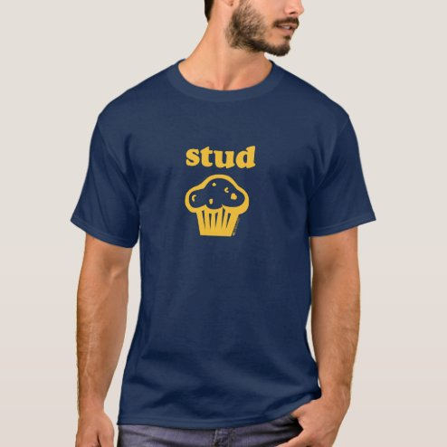

# DLS-ZZ-041 — STUD MUFFIN T-SHIRT - The original design!

Status: collected front-design reference; back unverified. No recipe-family synthesis.

- Product: https://www.zazzle.com/stud_muffin_t_shirt_the_original_design-235014122479181504
- Marketplace: Zazzle; creator: Not captured in collection card; attribution unresolved.
- Route: https://www.zazzle.com/c/mens+tshirts; page1, product-card position40; men. Popular selected;2026-10-20.
- Evidence: marketplace ordering, not audited sales/ranking window or causal proof. Founder-approved extension of4 references,2026-10-20.
- Source image: https://rlv.zcache.com/stud_muffin_t_shirt_the_original_design-rba8bef0df9b547efaa5ad63c60a74efc_k2g9y_494.jpg
- SHA-256: `487414bff7ca1bbe56066aa9c34f080af9ad14de33fedf8123d735b101976f0f`. Retained unedited displayed mockup; not physical sample.
- Eligibility: complete adult tee front design; no identified licensed character/celebrity. Back unverified. Actual fiber/print process, precise print size and wearer demographics unknown.
- Deduplication: additional distinct artwork after matching existing records across both gender routes. Global cross-source reconciliation still pending.

## Visual observation

Navy regular crew-neck on model. Small centered mustard-yellow bold lowercase stud above simple outlined muffin icon. Two-tier compact chest motif, one ink-like color and generous unprinted fabric. Icon supplies the missing word in visual pun; no frame, texture or other accents.

## Limits

Approximate proportions from mockup. Garment cut/color are observed, not verified physical specifications. No exact font ID, family classification or willingness-to-buy inference. Template/subject similarity alone is not proof of a shared recipe.
