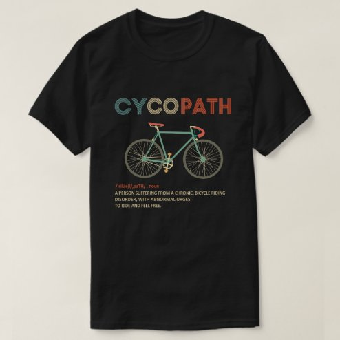

# DLS-ZZ-042 — Cycopath Funny Cycling for Cyclists and Bikers T-Shirt

Status: collected front-design reference; back unverified. No recipe-family synthesis.

- Product: https://www.zazzle.com/cycopath_funny_cycling_for_cyclists_and_bikers_t_shirt-235660001618954500
- Marketplace: Zazzle; creator: Not captured in collection card; attribution unresolved.
- Route: https://www.zazzle.com/c/mens+tshirts; page1, product-card position41; men. Popular selected;2026-10-20.
- Evidence: marketplace ordering, not audited sales/ranking window or causal proof. Founder-approved extension of4 references,2026-10-20.
- Source image: https://rlv.zcache.com/cycopath_funny_cycling_for_cyclists_and_bikers_t_shirt-re82cb3310c5d4529941cc3650418a02f_jgsdi_494.jpg
- SHA-256: `f61fc9107c5ea02274ceae5878b051c8e363dd85a485546ce291f07c1b4d8b29`. Retained unedited displayed mockup; not physical sample.
- Eligibility: complete adult tee front design; no identified licensed character/celebrity. Back unverified. Actual fiber/print process, precise print size and wearer demographics unknown.
- Deduplication: additional distinct artwork after matching existing records across both gender routes. Global cross-source reconciliation still pending.

## Visual observation

Black crew-neck flat image. Medium centered multicolor uppercase CYCOPATH above fine-line vintage road bicycle; tiny dictionary-style explanatory lines below. Muted teal/ochre/rust letters and bicycle details, subdued contrast on black. Header and bicycle share approximate width; tiny caption subordinate and close-reading dependent.

## Limits

Approximate proportions from mockup. Garment cut/color are observed, not verified physical specifications. No exact font ID, family classification or willingness-to-buy inference. Template/subject similarity alone is not proof of a shared recipe.
