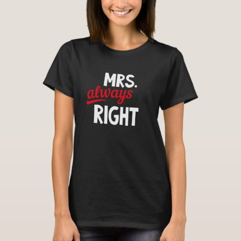

# DLS-ZZ-043 — Relation Husband Wife Right Mr. Mrs. Always Fight  T-Shirt

Status: collected front-design reference; back unverified. No recipe-family synthesis.

- Product: https://www.zazzle.com/relation_husband_wife_right_mr_mrs_always_fight_t_shirt-235035659649156209
- Marketplace: Zazzle; creator: Not captured in collection card; attribution unresolved.
- Route: https://www.zazzle.com/c/womens%2Btshirts; page1, product-card position27; women. Popular selected;2026-10-20.
- Evidence: marketplace ordering, not audited sales/ranking window or causal proof. Founder-approved extension of4 references,2026-10-20.
- Source image: https://rlv.zcache.com/relation_husband_wife_right_mr_mrs_always_fight_t_shirt-r42dde0a44748417e89b86192548138a9_k2grj_494.jpg
- SHA-256: `251bbc43f34c4105be089ca8ac2ccd68d18d50d7fea3cb94315e6f187f8237e8`. Retained unedited displayed mockup; not physical sample.
- Eligibility: complete adult tee front design; no identified licensed character/celebrity. Back unverified. Actual fiber/print process, precise print size and wearer demographics unknown.
- Deduplication: additional distinct artwork after matching existing records across both gender routes. Global cross-source reconciliation still pending.

## Visual observation

Black crew-neck on model. Small-to-medium centered white uppercase MRS. and RIGHT with red cursive always between them, slight informal slants. Three-line type-only stack; white large bottom word supplies weight, red script contrasts texture and color. Large blank torso area; complete predefined message, no surname placeholder.

## Limits

Approximate proportions from mockup. Garment cut/color are observed, not verified physical specifications. No exact font ID, family classification or willingness-to-buy inference. Template/subject similarity alone is not proof of a shared recipe.
