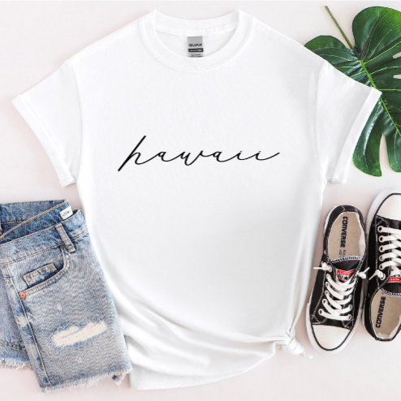

# DLS-ZZ-044 — Hawaii Script State Women’s T-Shirt

Status: collected front-design reference; back unverified. No recipe-family synthesis.

- Product: https://www.zazzle.com/hawaii_script_state_women_s_t_shirt-235944919556067510
- Marketplace: Zazzle; creator: Not captured in collection card; attribution unresolved.
- Route: https://www.zazzle.com/c/womens%2Btshirts; page1, product-card position28; women. Popular selected;2026-10-20.
- Evidence: marketplace ordering, not audited sales/ranking window or causal proof. Founder-approved extension of4 references,2026-10-20.
- Source image: https://rlv.zcache.com/hawaii_script_state_women_s_t_shirt-r_rffvd_494.jpg
- SHA-256: `fb1d63fe496cb9f172c4e9565174f86202f5eedc3b965d071e6efd847ad5f352`. Retained unedited displayed mockup; not physical sample.
- Eligibility: complete adult tee front design; no identified licensed character/celebrity. Back unverified. Actual fiber/print process, precise print size and wearer demographics unknown.
- Deduplication: additional distinct artwork after matching existing records across both gender routes. Global cross-source reconciliation still pending.

## Visual observation

White crew-neck flat laid with knotted hem. Thin black lowercase hawaii handwritten script runs horizontally across upper chest. Restrained scale and large white negative space, no illustration or border. Same visual template as California reference with changed word; preserve variant without overstating independent visual diversity. Accessories and knot are presentation context.

## Limits

Approximate proportions from mockup. Garment cut/color are observed, not verified physical specifications. No exact font ID, family classification or willingness-to-buy inference. Template/subject similarity alone is not proof of a shared recipe.
