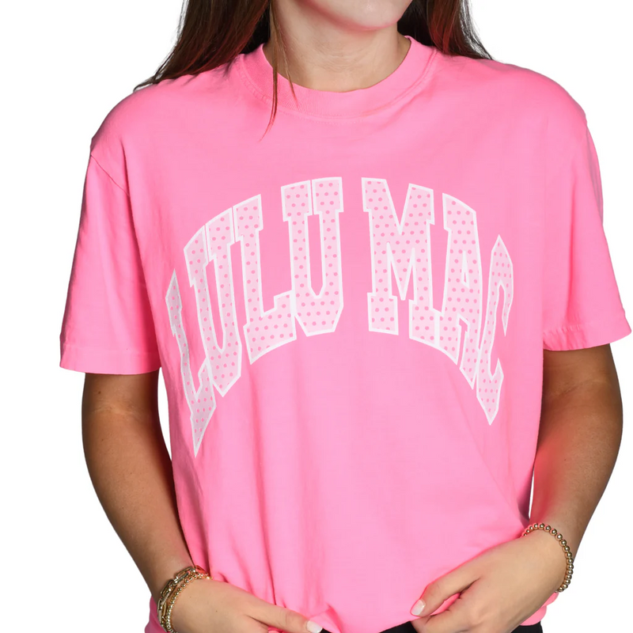

# Initial eight slots — historical first checkpoint

**Superseded status:** the [expanded 28-design batch](../discovery-28/README.md) now completes four per seven sources, including all four SimplyCuteTees slots. This page preserves the earlier five-source checkpoint and image paths; its open-slot statements below are historical.

October 19, 2026 session (October 20 UTC). **Five of eight slots filled: four The Bee & The Fox, one SimplyCuteTees. Three SimplyCuteTees slots remain open.** All admitted designs have visible front graphics. The Founder clarified that POD launches with front-only graphics; back-print sources are excluded, not relocated onto the front by assumption.

[Audience-fit decision](../Audience-Fit-and-Two-Stage-Selection.md) · [Four Bee & The Fox cards](BEE.md) · [Evidence manifest](source-manifest.json) · [Excluded back prints](excluded-back-prints.json)

Commercial evidence is seller-designated bestseller collection membership, not audited sales or proof that style caused demand. Collection position is a relocation aid, not sales rank. This purposeful sample is not representative of women or regions. Seller images may be styled or composited; physical fit and printing remain unverified. References are for internal study, not production reuse.

## Screening result and continuation

Four original SimplyCuteTees picks (Home Grown, Stay Sweet Pineapple, Watercolor Pig, Mama Bear) were removed after the front-only clarification; their images are excluded from the published bank. The earlier Country Roads candidate was also set aside and is not counted. Expanded checks covered 12 additional products on page 1 and six on page 2, using product images and/or explicit placement descriptions. Only Lulu Mac supplied a qualifying front treatment among those checks. The exclusion log preserves 21 back-print decisions; it is not a claim that every product on both pages was visually audited. Collection rosters preserve unreviewed candidates for continuation.

Keep the four-per-source target, but do not fill the remaining three slots with back graphics or silently substitute another seller. Resume SimplyCuteTees from the saved page rosters, skipping logged product IDs. The source is not declared exhausted. Remaining allocation across the broader approximately 28-shirt study still needs rebalancing.

All five are stage-1 discovery sources; stage-2 suitability for a particular audience, material and concept remains untested. No new recipe cluster, neutral reconstruction or applied-design validation is claimed.

## DLS-SCT-005 — Girlie Girl Lulu Mac Polka Dot Comfort Colors T-Shirt

[Product](https://www.simplycutetees.com/collections/best-selling/products/girlie-girl-lulu-mac-polka-dot-comfort-colors-t-shirt) · [Bestseller collection](https://www.simplycutetees.com/collections/best-selling) · page 1, position 25

**Visible relationships:** Broad collegiate arch in pale outlined slab capitals with pink polka-dot fill, on bright pink crewneck. Type itself is the graphic.

**Garment:** Seller names Comfort Colors and relaxed fit. Exact fiber and weight unknown; visible short sleeve crewneck.

**Source context:** Brand-name fashion statement; seller positions as nostalgic/retro casual apparel. Actual buyer demographics unknown.

**Transfer hypothesis:** Patterned collegiate lettering may suit a playful subgroup, but branding can explain appeal. Pattern must not undermine the new concept’s reading hierarchy. No evidence of fit for either treasure hunters or Asian-food lovers yet.

**Limits:** Front graphic visible; no back image or explicit blank-back confirmation. Admitted for study of front placement, not proof of an otherwise unprinted garment. Only primary view retained; brand affinity confound.

