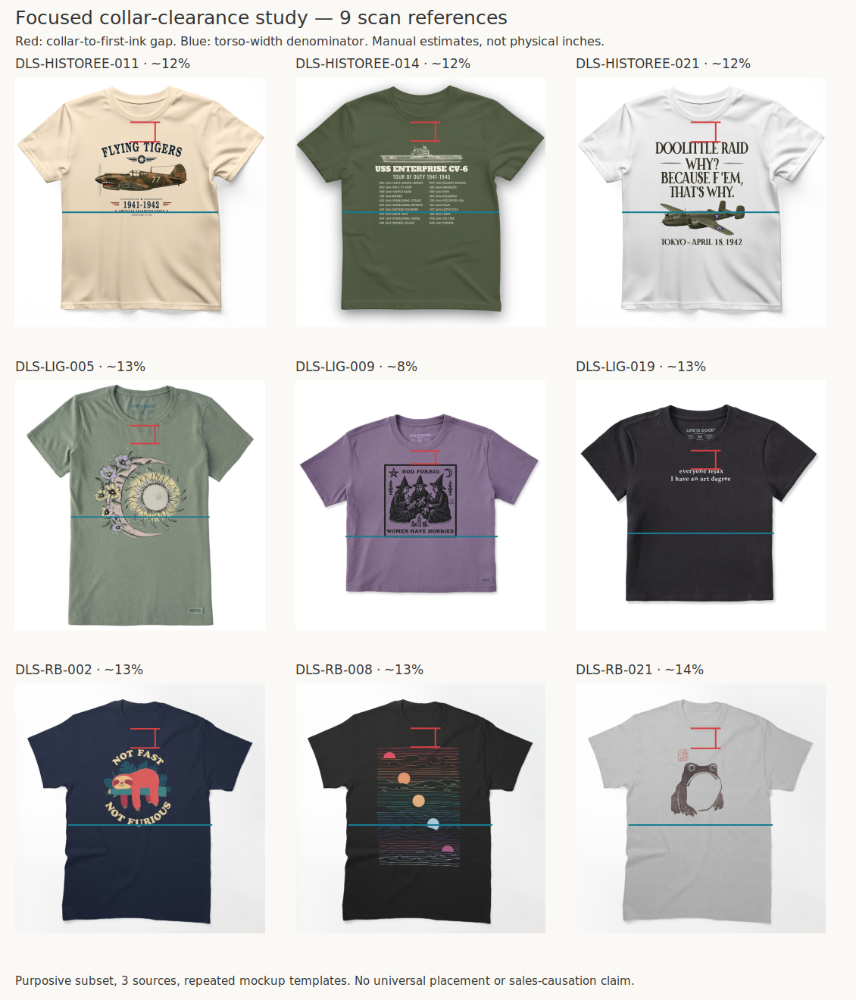

# Front placement study 01 — collar clearance

Creative Director · October 21, 2026 · Focused diagnostic study from the existing 220-reference collection.

## Decision

Add an explicit collar-clearance check to placement review. The round03 CAR: WRONG files controlled the artwork footprint but used a 0.5-inch offset from the **print-area origin** without adequately judging the resulting gap from the collar. Founder found both too high. Correct file dimensions did not establish good garment placement.

The references below support testing a lower placement. They do **not** establish a universal physical distance from the neckline or prove that placement caused their commercial performance.

## Method and observations

Reviewed selected contact sheets from the existing collection, then inspected nine usable full-front references from HistoreeTees, Life is Good and Redbubble. This was a purposive, small diagnostic subset, not a new placement census of all 220. It includes arched text, small typography, object illustrations and tall compositions. Worn, cropped or obscured images were not used for numerical measurements. The Founder’s raccoon reference, DLS-ETSY-022, informs Heritage style but is not a calibration image.

Define the gap as the vertical image distance from the **lowest outer edge of the front neck rib at center** to the **highest visible design ink**, including an arch peak, accent or separate stamp. Divide by the visible torso width below the sleeves, excluding sleeve span. Ignore an interior manufacturer neck label. Both endpoints and the denominator are manual estimates; annotate them so they can be challenged.

| Reference | Approximate gap / torso width | Source record |
|---|---:|---|
| DLS-HISTOREE-011 | 12.5% | [Record](../../sourcing/expanded-scan/records/DLS-HISTOREE-011.md) |
| DLS-HISTOREE-014 | 11.9% | [Record](../../sourcing/expanded-scan/records/DLS-HISTOREE-014.md) |
| DLS-HISTOREE-021 | 12.4% | [Record](../../sourcing/expanded-scan/records/DLS-HISTOREE-021.md) |
| DLS-LIG-005 | 13.0% | [Record](../../sourcing/expanded-scan/records/DLS-LIG-005.md) |
| DLS-LIG-009 | 8.5% | [Record](../../sourcing/expanded-scan/records/DLS-LIG-009.md) |
| DLS-LIG-019 | 12.5% | [Record](../../sourcing/expanded-scan/records/DLS-LIG-019.md) |
| DLS-RB-002 | 13.3% | [Record](../../sourcing/expanded-scan/records/DLS-RB-002.md) |
| DLS-RB-008 | 13.0% | [Record](../../sourcing/expanded-scan/records/DLS-RB-008.md) |
| DLS-RB-021 | 13.9% | [Record](../../sourcing/expanded-scan/records/DLS-RB-021.md) |

Report the pattern as roughly **8–14%**, with approximately ±2–3 percentage-point visual uncertainty, rather than interpreting the decimal places as precision. [Image-space landmarks](measurements.json) retain the estimates. Repeated seller mockup templates mean these are not nine independent placement decisions. Garment cuts, neck shapes, image distortion and source size differ. These ratios cannot be converted into collar inches without verified geometry.

Round03’s saved flat Pepper preview has an estimated collar-to-ink gap near 5–7% of torso width. Its draped design-editor view presents a different relationship. The discrepancy itself is a reason to inspect the actual provider mockup rather than transplant an image-space ratio between presentations.

## Application

[CAR: WRONG round04](../../applications/CAR-WRONG-04/README.md) holds the selected visible width at 8.5 inches and compares 0.5, 1.5 and 2.0-inch top offsets from the print-area origin. The 1.5-inch option is a **one-inch downward layout shift**, not a claim of 1.5 inches below the collar. The study motivates the comparison; whole-shirt judgment and provider verification select the execution.

For future work, compare another vertical position when collar crowding or an unusually high/low optical center is apparent. Assess the bottom edge too; lowering a tall composition can create a different problem. Do not make 8–14% or this application’s inch values a mandatory range. Establish a physical collar offset only from an authoritative template or a measured garment/sample.

## Provenance

All source images and original commercial signals remain in their linked collection records. The annotated board adds measurement guides only. The study does not alter source admission, rankings, family membership or sales-evidence strength. It adds a garment-integration judgment to the [canonical workflow](../../Garment-and-Placement-Workflow.md).
